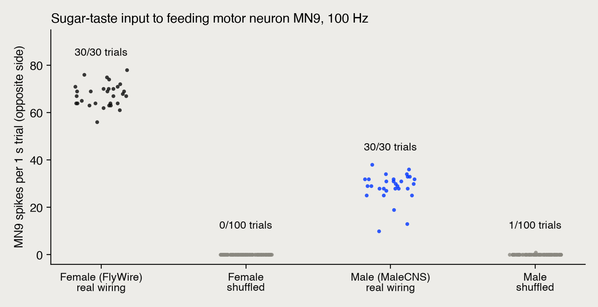
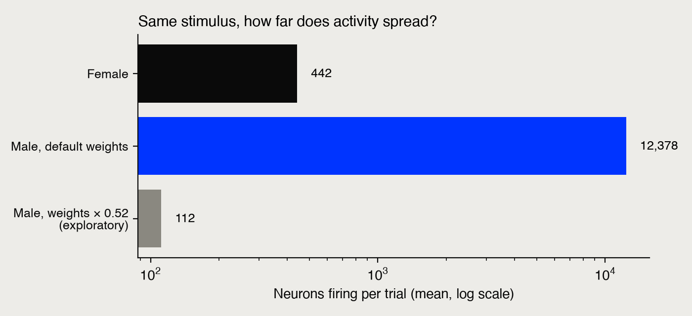
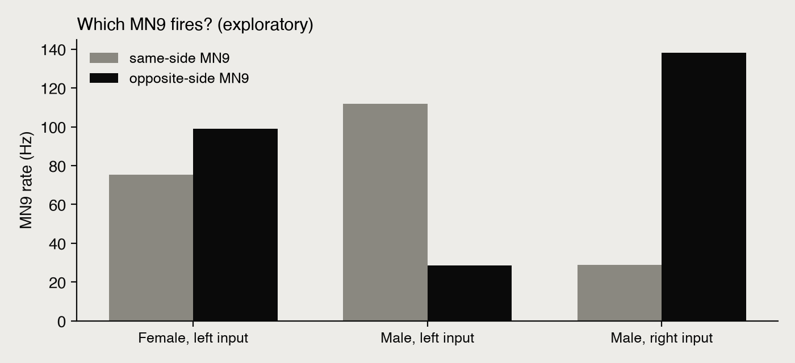

# Results: same simulation, different fly

**Status:** our own analysis, not peer-reviewed. Pre-registered in `PLAN.md` (git `f6e8c13`, 9 Oct 2026 09:22 ET) before any stimulated run.

All numbers come from:
- `results/summary.json`, written by `code/analyze.py` (the pre-registered tests)
- `results/exploratory.json`, written by `code/explore.py` (the exploratory work, including the audit checks A1–A5)

Every condition ran through `run_compute` (local jobs `job-1791552194643-87dc7039`, `job-1791552348329-0fb15612`, `job-1791555076914-99665cd2`, `job-1791555893905-fefe7dac`).

**Audit, 9 Oct 2026.** An independent blind audit checked all of this. The code is correct, and over 40 reported numbers recompute exactly from the raw spike files. Re-running E1 (seed 10000) and E2 (seed 20003) gives bit-identical output. **No pre-registered verdict changes.** The audit did find one data-quality problem in the male readout neuron and several wording overclaims. All are corrected below, and every correction is listed under "Corrections" at the end.

## Verdicts on the pre-registered hypotheses

| | Hypothesis | Result | Verdict |
|---|---|---|---|
| **H1** | Shiu et al.'s model on Shiu's data (FlyWire v630, their 21 GRNs, 100 Hz) drives contralateral MN9 | MN9 active in **30/30** trials, **67.5 ± 4.8 Hz**. The authors' archived run of the same condition gives 67.0 Hz (30/30), well within trial-to-trial noise (s.e.m. ≈ 0.9 Hz). This is a **computational reproduction** (same code, same data), not an independent replication. | **Supported** |
| **H2** | Shuffled wiring abolishes it | **0/100** shuffled connectomes drove MN9. Fisher's exact test vs H1: p = 3.8 × 10⁻³⁰. The paper reports 1/100. | **Supported** |
| **H3** | The unchanged model on the **male CNS** drives contralateral MN9 | Pre-registered readout MN9_R active in **30/30** trials at 28.7 ± 5.9 Hz. **But see A1:** the male dataset flags this neuron "RT Hard to trace". | **Supported** under the pre-registered rule |
| **H4** | Shuffled wiring abolishes it in the male CNS | **1/100** shuffled connectomes drove MN9_R (mean 0.01 Hz). Fisher's exact test vs H3: p = 1.2 × 10⁻²⁸. | **Supported** |
| **D1** | The *whole* response pattern transfers (type-level) | Spearman ρ female vs male real = 0.110 (3,804 types). Female vs male shuffled = 0.150. Difference = −0.04, so it fails the ≥ 0.2 bar. On a fixed set of the 258 types active in the female: real 0.428, shuffled 0.456. Same conclusion. | **Not supported** |

### A1. The pre-registered male readout neuron is incompletely reconstructed (found in audit)

| MN9 | Input synapses in our network | Dataset status |
|---|---|---|
| Female, right (`720575940660219265`) | 5,579 | — |
| Female, left (`720575940618238523`) | 5,886 | — |
| Male MN9_L (`10331`) | 6,012 | "Roughly traced" |
| **Male MN9_R (`16949`)** | **555** | **"RT Hard to trace"** |

MN9_R has about a tenth of the input of every other MN9, so its firing rate isn't comparable to anything. **Don't compare male and female MN9 rates using MN9_R.**

### A5. The same tests with the well-traced male MN9_L (exploratory, uses existing runs)

| Condition | MN9_L active | Rate |
|---|---|---|
| Left-side input, real wiring | **30/30** | 111.8 Hz |
| Left-side input, **shuffled** wiring | **1/100** | 0.04 Hz (Fisher p = 1.2 × 10⁻²⁸) |
| Right-side input (contralateral), real wiring | **30/30** | 138.1 Hz |
| Left-side sugar-only input | 30/30 | 76.3 Hz |

**Conclusion:** the transfer result doesn't depend on the bad neuron. With the well-traced MN9_L, the feeding neuron fires with real wiring and almost never with shuffled wiring. This is the readout the video should use. It's labelled exploratory because we picked it after seeing A1.

**Secondary conditions (descriptive).** In each one, the pre-registered readout was active in 30/30 trials:

| Condition | Readout | Rate |
|---|---|---|
| Female, type-defined stimulus (52 GRNs) | MN9 (contralateral) | 99.1 ± 5.3 Hz |
| Female, sugar-only stimulus | MN9 (contralateral) | 73.0 ± 3.7 Hz |
| Male, sugar-only stimulus | MN9_R | 16.8 ± 7.5 Hz |
| Male, right-side stimulus | MN9_L | 138.1 ± 26.3 Hz |


*Fig 1.* MN9 spikes per 1 s trial at 100 Hz input. Female uses Shiu et al.'s 21 GRNs on FlyWire v630. Male uses the 32 left-side GRNs of the same four types, read out at the pre-registered MN9_R. Shuffled means signed weights permuted across existing edges, with a new permutation each trial. *To do: redraw with MN9_L for the video (see A5).*

## Exploratory analyses (post hoc, NOT pre-registered)

**X1 / A2. Activity spread.** The same stimulus spreads far wider in the male network. Counts below exclude the stimulated sensory neurons themselves.

| Condition | Non-stimulated neurons firing per trial |
|---|---|
| Female | 390 |
| Male | 12,346 |

That's about 32× more neurons. The most active male cell types are memory and navigation types: MBONs, APL, DPM, ExR ring neurons and PEN. The most active female types are feeding-circuit types. The female and male stimuli also differ in size (52 vs 32 GRNs).

Including the GRNs, the counts were 442 vs 12,378, and spikes per trial were 17,721 vs 593,811.

This spread is *consistent with* D1's failure. We haven't shown it causes it.

**X3 / A3. The two maps record different amounts of synaptic input per neuron.**

| Measure | Male CNS | FlyWire v783 |
|---|---|---|
| Input synapses per neuron, whole map | 751 | 393 |
| Input synapses per neuron, male brain only (VNC excluded) | 717 | — |
| Synapses per connected pair | 4.85 | 3.61 |

The strongest test compares **like with like**. Across **7,081 cell types** present in both maps, the same type of neuron receives a median **1.78× more synaptic input** in the male map (interquartile range 1.42–2.34×). So the difference is map-wide, not just extra tissue.

What this means for the model: the weight per synapse is identical, but each male neuron receives about 1.8–1.9× more total input. Shiu's single free parameter (w_syn) was tuned on FlyWire counts. We can't tell from these data whether the 1.78× is biology (sex, individual) or measurement (synapse detection, pipeline). Most likely it is mostly measurement, but that's our inference.

**X4. Rescaled-weight test.** We scaled w_syn by 393/751 = 0.523 and ran 30 trials.
- **The runaway stops:** 80 non-stimulated neurons fire per trial, against 12,346.
- **The most active cell types now overlap with the female's.** Top-50 overlap is 35%, against 3% at default weights. The audit found the Spearman ρ comparison is sensitive to which types are compared, so we no longer use it.
- **But MN9 goes silent.** MN9_R fired in 0/30 trials and MN9_L in 1/30 (0.03 Hz).

At default weights MN9 fires but activity runs away. At density-matched weights the active types overlap more with the female's, but MN9 doesn't fire. **Of the two settings we tested, neither gives both.** The planned 0.6–0.9 sweep (X5) didn't run; its approval timed out.

**X2. The male "laterality reversal" is a reconstruction artefact.** In the male, MN9_L fires strongly from either side (111.8 Hz ipsilateral, 138.1 Hz contralateral), while MN9_R stays weak (28.7 and 28.8 Hz). A1 explains this: MN9_R is only partly reconstructed. Using the well-traced MN9_L, contralateral input drives it harder than ipsilateral (138 vs 112 Hz). That is the same direction as the female (99 vs 75 Hz) and as the paper. The two male stimuli differ slightly (36 vs 32 GRNs), so this is suggestive only.




**Shuffle sanity check (`code/check_shuffle.py`, confirmed by the audit):**
- One permutation on FlyWire v630 changed 84.8% of 14,687,178 edge weights.
- The sorted weights, their sum and the inhibitory fraction (40.08%) were all unchanged.
- The 100 shuffled trials used 100 distinct seeds.

## Caveats

- **C1.** The male MN9 result rests on a network where activity runs away (X1). At density-matched weights, MN9 is silent (X4). So "the prediction transfers" holds only in the narrow sense we tested: MN9 fires with real wiring and not with shuffled wiring, and that holds for both male MN9s (H3, A5). It does **not** mean the male model reproduces the female's circuit mechanism.
- **C2.** Fly, sex and mapping pipeline are confounded. The male map used different imaging (FIB-SEM vs serial-section TEM), synapse detection and neurotransmitter prediction. Our design can't separate biology from measurement.
- **C3. Sign rule.** We used each neuron's top transmitter, where the paper uses a ">50% of sites" rule. 14,365 male neurons with an "unclear" transmitter, and 502 with none, were treated as excitatory. The audit found that switching these to the dataset's consensus calls changes only 0.4% of synapses (inhibitory share 37.4% → 37.7%), so this can't explain X1.
- **C4. Software and settings.** Brian2 2.7.1 instead of 2.5.1. One stimulus rate (100 Hz). 1 s trials.
- **C5. Stimulus definitions.** In today's FlyWire annotations, Shiu's 21 "sugar" GRNs include 5 typed LB3d (high salt/heavy metal) and 4 LB4b (putative attractive). Our type-defined stimuli use **all** GRNs of the same four types: sugar types are 33/52 (63%), against 11/20 typed (55%) in Shiu's set. The sugar-only stimuli use LB3b and LB3c only.
- **C6. Type matching in D1** drops 2,773 male neurons whose `flywireType` lists several types. It also averages only over neurons that spiked. Counting silent members as 0 gives real 0.116 vs shuffled 0.202, so the verdict doesn't change.

## One-paragraph summary (for the video and description)

We re-ran Shiu et al.'s whole-brain fly model with their own code and data and got their number back (67.5 vs 67.0 Hz). Shuffling the wiring killed the effect: 0 of 100. Then we ran the same model, unchanged, on the 2026 male fly map. Sugar input still drove the feeding neuron in 30 of 30 trials, and shuffled wiring killed it again (1 of 100). That held for both of the male fly's feeding neurons, including the one that is fully mapped. But the rest of the male brain didn't behave like the female's. Activity snowballed to about 30× more neurons. The male map records about 1.8× more synaptic input per neuron for the same cell types, so the model's one tuning knob, set for the first map, is too strong for the second. Turning it down stopped the snowball, but then the feeding neuron went quiet. This is our own unreviewed analysis.

## Corrections made after the audit (9 Oct 2026)

1. **A1 added:** the pre-registered male readout (MN9_R) is flagged "RT Hard to trace", with 555 input synapses against about 6,000 for the other MN9s.
2. **A5 added:** the result holds with the well-traced MN9_L (30/30 vs 1/100).
3. **X2 reattributed** to that reconstruction problem.
4. **"1.9× harder" corrected:** the weight per synapse is identical. Each male neuron receives about 1.8–1.9× more input, and 1.78× type-matched.
5. **X4 ρ claim withdrawn,** because it depends on which types are compared. The top-50 overlap is kept.
6. **"Replication" changed to "reproduction"** for H1 and H2.
7. **Spread counts now exclude stimulated neurons:** 32× rather than 28×.
8. **"This is why D1 fails" softened** to "consistent with".
9. **C5 and C6 wording corrected.**

## Reproduce

```
cd video-01-fly-brain/experiment
uv venv --python 3.11 .venv && uv pip install --python .venv/bin/python brian2==2.7.1 "numpy<2.1" pandas pyarrow joblib matplotlib scipy "cython<3.1"
git clone https://github.com/philshiu/Drosophila_brain_model vendor/Drosophila_brain_model   # commit 91bdd1e
# male CNS v1.0 tables -> data/malecns (URLs in PLAN.md; SHA-256 in data/malecns/SHA256SUMS)
# FlyWire annotations -> data/flywire/neuron_annotations.tsv (flyconnectome/flywire_annotations, Supplemental_file1)
.venv/bin/python code/prepare_inputs.py
for c in E1_fw630_shiu_real E2_fw630_shiu_shuffled E3_fw783_typeset_real E3_mcns_typesetL_real E4_mcns_typesetL_shuffled S1_fw783_sugaronly_real S1_mcns_sugaronlyL_real S2_mcns_typesetR_real X4_mcns_typesetL_wscaled; do .venv/bin/python code/run_sim.py $c 4; done
.venv/bin/python code/analyze.py && .venv/bin/python code/explore.py && .venv/bin/python code/figures.py
```

## Open items

- [x] X4 analysis is folded into `code/explore.py`, and a fresh run reproduces every number.
- [ ] Redraw Fig 1 with MN9_L for the video.
- [ ] Follow-up experiments: see `PLAN2.md`.
- [ ] Before release: write our own README, add an MIT licence, push the code to GitHub and the result parquets to Zenodo (the parquets are gitignored), and link both in the description.
