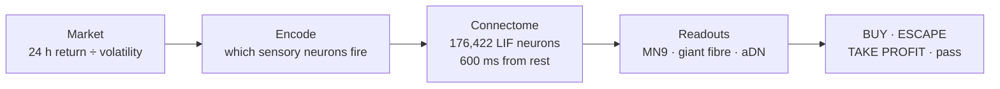

# TraderFly — the brain

A fruit fly's brain decides what to trade. Not a model trained on charts: the wiring diagram of a real *Drosophila* central nervous system — **176,422 neurons and 6,287,749 synaptic connections** — simulated spike by spike. A token's price action becomes something the fly can taste or see; whether it eats is up to its neurons.

This repository is the mechanics: the connectome, the simulation, and how a market becomes a stimulus and a stimulus becomes a decision.

- **Live:** [traderfly.xyz](https://traderfly.xyz) — feed the fly a token and watch its neurons fire
- **$TFLY** on Robinhood Chain: `0xaEa02FA4a85437C5DF4e988CEBf2E93Ae9A7B90A`

## How one decision works



Every decision starts from a fresh, silent brain (persistent activity would leak one token's taste into the next). The stimulus is Poisson spiking on a set of real sensory neurons; the rest is the connectome.

| The fly is… | Stimulus (real neurons) | Read out at | Action |
|---|---|---|---|
| offered a rising token, z ≥ 0.5 | sugar receptors, 120 Hz | MN9 — proboscis motor neuron (feeding) > 20 Hz | **BUY** |
| offered a weakly rising token, 0.25 ≤ z < 0.5 | sugar **and** bitter, 120 Hz | MN9 > 20 Hz | BUY, else **REJECT** |
| offered anything else | nothing to taste — no stimulus | — | **IGNORE** |
| holding a token that turns against it | looming (LC4 + LPLC2 visual neurons), 150 Hz | giant fibre (escape) fires | **ESCAPE** — sells |
| holding a token after a run-up and pullback | Johnston's organ wind/gravity + grooming neurons, 150 Hz | aDN (antennal grooming) > 20 Hz | **TAKE PROFIT** — sells |

`z` is the token's 24 h log return divided by its daily volatility (both from hourly candles), so a 5% move means something different for a stock and for a memecoin.

**Kept private:** the exit rules — how far down counts as danger, and how far up and back as profit. Published, they would tell anyone exactly how far to push a price to make the fly sell. When a rule fires, the fly is shown the stimulus above; its neurons still decide.

**Why falling tokens get nothing, not bitter:** encoding a falling token as bitter on its own set off a network-wide burst (~422,000 spikes) that drove MN9 to ~56 Hz — the fly *ate* it. In this connectome bitter only suppresses feeding alongside sugar, so that is the only way it is used.

## The simulation

A leaky integrate-and-fire network in TypeScript ([`packages/brain`](packages/brain/src/lif.ts)), following Shiu et al.'s Brian2 model: resting and reset −52 mV, threshold −45 mV, membrane time constant 20 ms, synaptic time constant 5 ms, refractory 2.2 ms, synaptic delay 1.8 ms, 0.5 ms steps. Synaptic weights are signed by each neuron's predicted neurotransmitter. Seeded, so the same input gives the same spikes.

The connectome is Janelia FlyEM's **male CNS v1.0**, fetched from [neuPrint](https://neuprint.janelia.org) (no account needed) and packed into a compact binary ([`packages/connectome`](packages/connectome/src)). Neuron sets — sugar and bitter gustatory receptors, MN9, LC4, LPLC2, the giant fibres, aDN — are resolved by cell type.

## Run it

Node 22+.

```sh
npm install
npm run build:connectome                 # downloads the connectome from neuPrint → data/connectome.bin
npm run decide -- offer 0.40 0.60        # a token up 40% (log) with 60%/day volatility
npm run decide -- danger                 # does the giant fibre fire?
npm run validate                         # the four checks below
npm test
```

## Checks

[`packages/validate`](packages/validate/src/experiments.ts) runs four experiments against this engine: a silent brain stays silent; sugar drives MN9; bitter suppresses sugar-driven feeding; looming drives the giant fibre. They are modelled on the summary table of the reference implementation (`blendi-remade/fly-brain-minecraft`), not a full re-run of the paper's protocol — read them as checks that the engine behaves like the model, not as a reproduction of the paper.

## What's not here

The app (the 3D fly, its desk, the site), the trading engine and the fly's wallet, payments, and the exit rules. No keys, no secrets.

## Credits

- Shiu, P. K. et al. *A Drosophila computational brain model reveals sensorimotor processing.* Nature (2024) — the leaky integrate-and-fire model and its parameters.
- Janelia FlyEM — the male CNS connectome, served by neuPrint. See neuPrint for the data's terms of use.
- `blendi-remade/fly-brain-minecraft` — the reference implementation this port was checked against.

## License

© 2026 TraderFly. All rights reserved. Published for transparency — see [NOTICE](NOTICE.md).
