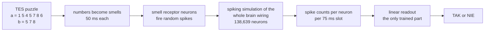
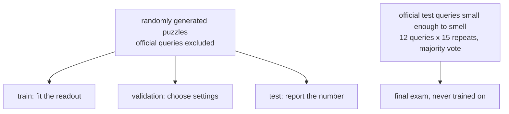

# Can a fruit fly brain solve an olympiad problem?

[](pyproject.toml)
[](tests)
[](https://zenodo.org/records/10676866)
[](LICENSE)

I took the complete wiring diagram of an adult fruit fly brain (**138,639 neurons, 15.1 million connections**,
traced from electron microscope images by the FlyWire project), simulated it as a spiking neural network, and gave
it a task from the **Polish Olympiad in Informatics**: *TES, "Test na inteligencję"* (XVII OI, stage I).

**Short answer: no, not in this model.** The more interesting part is *why*, and what it takes to give the fly a
fair chance.


**Live write-up with interactive figures:** https://tomkemonke.github.io/fly-brain-olympiad/

---

## Contents

1. [The puzzle](#1-the-puzzle)
2. [How a fly takes the test, step by step](#2-how-a-fly-takes-the-test-step-by-step)
3. [Round 1 results](#3-round-1-results)
4. [Why it failed: looking inside the brain](#4-why-it-failed-looking-inside-the-brain)
5. [Round 2: a fairer rerun](#5-round-2-a-fairer-rerun)
6. [Engineering notes](#6-engineering-notes)
7. [Reproduce it](#7-reproduce-it)
8. [Limitations](#8-limitations)
9. [Data and credits](#9-data-and-credits)

## TL;DR

| | |
|---|---|
| **Round 1** | A trained linear readout of the simulated brain answered **52.8%** of 600 held-out puzzles correctly (coin flip: 50%), *worse than the raw smell input it was given* (61.8%) and no better than a randomly rewired brain (55.0%). On the official test queries: **5 of 12**. |
| **Why** | The published model has no short-term memory (activity fades within tens of milliseconds, but the task needs a whole sequence remembered), and smells flood it: from 20 Hz up, **every number lights up the same 73% of mushroom body cells**. |
| **Round 2** | Adding two kinds of neuron fatigue that real neurons have (spike-frequency adaptation and synaptic depression) stops the flooding: the brain names the number it is smelling **89%** of the time mid-stream, versus 30% without. A four-task ladder to test what that buys was designed and calibrated; running it fully needs about 12 hours of CPU. |

---

## 1. The puzzle

> Given a sequence `a` and many queries `b`, answer for every query whether `b` can be obtained from `a` by
> crossing numbers out (keeping the order). Up to 1,000,000 numbers, values up to 1,000,000.

The task statement's own example, `a = 1 5 4 5 7 8 6`:

| query `b` | answer | why |
|---|---|---|
| `1 5 5 8 6` | TAK | every number found in order |
| `2 2 2` | NIE | there is no 2 in `a` |
| `5 7 8` | TAK | 5, then 7, then 8 |
| `1 5 7 4` | NIE | all numbers exist, but the 4 comes too early |

The classic solution walks through `b` and always takes the **earliest** matching position after the previous
match. Storing the positions of every value once and binary-searching them answers all queries in
**O((m + total length of b) log m)**:


[`solution/tes.py`](solution/tes.py) passes all 25 official tests. That is the bar. Now the fly.

---

## 2. How a fly takes the test, step by step



### Step 1. Load the wiring

The FlyWire connectome (release 783) lists which neuron connects to which, with how many synapses, and whether the
sending neuron is excitatory or inhibitory (predicted from its neurotransmitter). I use the processed version from
Shiu et al. 2024: 138,639 neurons and 15,091,983 connections, plus FlyWire's cell annotations to find smell
receptors, Kenyon cells and descending neurons.

### Step 2. Make every neuron a leaky integrate-and-fire unit

Same equations and constants as the published whole-brain model (Shiu et al. 2024, *Nature*):

$$
\tau_m \frac{dv}{dt} = v_0 - v + g, \qquad \tau_s \frac{dg}{dt} = -g
$$

A neuron spikes when $v > -45$ mV, resets to $-52$ mV and stays refractory for 2.2 ms. Every spike of neuron $j$
adds $w_{ij} = 0.275\text{ mV} \times n_{ij} \times s_j$ to $g_i$ after a 1.8 ms delay ($n_{ij}$ synapses, sign
$s_j = \pm 1$), with $\tau_m = 20$ ms and $\tau_s = 5$ ms. The linear part is integrated **exactly** over each
0.1 ms step ($u = v - v_0$):

$$
u(t+\Delta t) = u(t)\,e^{-\Delta t/\tau_m} + g(t)\,\frac{\tau_s}{\tau_s - \tau_m}\left(e^{-\Delta t/\tau_s} - e^{-\Delta t/\tau_m}\right)
$$

**Check before trusting it:** the published model's headline result is that sugar-sensing neurons drive MN9, the
motor neuron that extends the proboscis to feed. This implementation reproduces it: **MN9 fires at 71.5 Hz with
sugar input and stays silent without** ([log](results/round1/sugar_mn9_validation.log)).

### Step 3. Turn numbers into smells

Each number 1-9 drives one type of olfactory receptor neuron with random (Poisson) spikes for 50 ms, one number per
75 ms slot: first `b`, a pause, then `a`, then a silent readout slot.


### Step 4. Simulate only what can fire, and prove nothing changes

A neuron that never spikes cannot influence anything, so a pilot on the **full** brain finds every neuron that
spikes or comes within 3 mV of threshold, and the experiment runs on that subnetwork. Then fresh trials are run on
both the full and the trimmed brain with identical random input: the spike trains must match.


Trials run side by side as (neurons x trials) arrays, and the same random seeds feed every condition, so the real
brain and its controls receive exactly the same smells.

### Step 5. Read the answer out

The brain is **never trained**: no synapse changes. The only learned part is a linear classifier that looks at the
log spike count of every neuron in every 75 ms slot (about 140,000 features) and outputs TAK or NIE. That is the
most generous question you can ask: *is the answer present in the activity at all?* The mushroom body readout is
also biologically meaningful, since mushroom body output neurons are a learned linear readout of Kenyon cells.

The round 1 response matrix has 450 million nonzero entries, too big to fit a model on directly. An L2-regularised
linear model's weights always lie in the span of the training trials, so it is fitted **exactly** on the trial by
trial Gram matrix instead (3,180 x 3,180):

$$
\hat t(x) = k(x)^\top (K + \lambda I)^{-1}\, t, \qquad K_{ij} = x_i^\top x_j
$$

### Step 6. Grade it without fooling yourself



Every result is compared with controls: **always answering TAK**, **a readout of the raw smells with no brain**,
**the same brain with its wiring randomly shuffled** (same neurons, same connection counts, same signs), and **a
trained artificial neural network** as an upper reference.

---

## 3. Round 1 results


| Readout | 600 held-out puzzles | wrong-order puzzles | official exam |
|---|---|---|---|
| Always answer TAK | 51.8% | 0% | 8 / 12 |
| Raw smells, no brain | 60.8% | 62.3% | 6 / 12 |
| Randomly rewired brain | 55.0% | 55.0% | 3 / 12 |
| **Fly brain, whole** | **52.8%** | **52.3%** | **5 / 12** |
| Fly brain, smell receptors only | 61.8% | 64.2% | 5 / 12 |
| Fly brain, mushroom body | 56.8% | 60.3% | 8 / 12 |
| Fly brain, neurons that drive the body | 48.3% | 47.7% | 4 / 12 |
| Trained artificial network (not a fly) | 79.7% | 80.8% | 10 / 12 |

Split by kind of puzzle: on the hard kind, where every number is present but the order is wrong, the fly brain does
no better than the raw smells with no brain at all (52% whole brain, 60% mushroom body, 62% no brain):


And the exam, query by query. The readout often votes with confidence, in both directions, and is right 5 times
out of 12:


**What it means**

- **The brain loses information.** Its activity is harder to read (52.8%) than the smell signal going into it (61.8%).
- **The real wiring didn't help.** A randomly rewired brain did as well (55.0%).
- **Nothing reaches the body.** The neurons that send commands to the body are at chance (48.3%).
- **It keeps nothing.** 75 ms after the last smell the activity is uninformative (49.7%), yet the task needs a whole sequence held in mind.

---

## 4. Why it failed: looking inside the brain

The same puzzle, played to two brains. In round 1 the brain is flooded: almost every sampled neuron fires almost all
the time, whichever number is being smelled. With short-term memory (round 2, below) activity is sparse and tied
to the smells.


Measured directly: in the plain model, from 20 Hz of receptor drive up, the set of Kenyon cells a number activates is
**identical** for every number (overlap 1.00), so the brain's learning centre cannot tell 1 from 9.


---

## 5. Round 2: a fairer rerun

Three fixes, all decided before any task was run:

**1. Short-term memory.** Real neurons tire. Two textbook mechanisms were added on top of the published model:

$$
\tau_m \frac{dv}{dt} = v_0 - v + g - a, \quad \tau_a \frac{da}{dt} = -a, \quad a \leftarrow a + b \text{ at every spike}
$$

$$
\text{a spike of } j \text{ delivers } w_{ij}\, x_j, \text{ then } x_j \leftarrow (1-U)\, x_j, \qquad \tau_{rec} \frac{dx_j}{dt} = 1 - x_j
$$

| preset | adaptation $b$ | $\tau_a$ | depression $U$ | $\tau_{rec}$ |
|---|---|---|---|---|
| mild | 0.1 mV | 200 ms | 0.05 | 300 ms |
| strong | 0.5 mV | 800 ms | 0.2 | 1000 ms |

**2. Realistic smells at a calibrated strength.** Every number now activates a blend of 3 receptor types, like a
real odor. The strength was chosen per memory preset by what every task needs first: naming the number being smelled
*right now*, in the middle of a stream of smells.


| memory | strength chosen | best score naming the current smell (chance 11%) | Kenyon cells active |
|---|---|---|---|
| none | 3 Hz | 30% (projection neurons) | 38.5% |
| mild | 40 Hz | 56% (Kenyon cells) | 14.1% |
| strong | 40 Hz | **89%** (projection neurons) | 3.0% |

**3. A ladder of tasks instead of one pass/fail.** *Same or different? Was it in the list? Which came first?* Then
full TES, each with train, validation and test sets and 95% confidence intervals. The ladder is learnable (a trained
network gets 98-100% on the first three rungs) and cannot be solved by simply adding up the smells:


**Status.** Calibration, trimming for strong memory (0 spike mismatches) and every baseline are done and committed.
The full ladder under every condition is an unattended, resumable pipeline
([`experiments/round2/pipeline2.py`](experiments/round2/pipeline2.py)) estimated at about 12 hours on a 6-core
desktop, and has not been run to completion.

---

## 6. Engineering notes

- **Simulator.** Vectorised NumPy/SciPy leaky integrate-and-fire engine with exact exponential integration, a ring
  buffer for synaptic delays, and many trials per process. Validated against the published MN9 result, and
  regression-checked to reproduce round 1 to the spike after round 2's memory was added.
- **Exact trimming.** Only 9.8% of the brain is simulated in round 1, with identical spike trains on held-out trials
  (5,284,179 spikes in both). Same check in round 2: 44,540 spikes in both.
- **Memory-safe readout.** A 5.4 GB response matrix is reduced to an exact trial-by-trial kernel, built in chunks.
  The kernel version reproduces the direct fit's scores exactly.
- **Measured, not assumed.** A C sparse-matrix-product propagation was benchmarked against `np.add.at`: identical
  statistics (per-neuron correlation 0.9995), but 0.9x the speed, so it was dropped.
- **Honest evaluation.** Official queries are excluded from generated data, test sets stay untouched until the end,
  every claim has a control, and calibration rules are recorded, including the two that were dropped.
- **Tests.** 18 unit tests: the greedy check against brute force, the official solution against the greedy check,
  the simulator on hand-built networks (including trimming exactness), and the readout kernel identity.

---

## 7. Reproduce it

```bash
git clone https://github.com/TomkeMonke/fly-brain-olympiad && cd fly-brain-olympiad
pip install -e ".[test]"
pytest                                   # 18 tests, no downloads needed
python scripts/download_data.py          # connectome, about 135 MB

# round 1 (about 3 hours on a 6-core CPU)
python experiments/round1/validate_sugar.py
python experiments/round1/prune.py --net fly  && python experiments/round1/run_tes.py --net fly
python experiments/round1/prune.py --net shuf && python experiments/round1/run_tes.py --net shuf
python experiments/round1/analyze.py fly shuf

# round 2 (resumable, about 12 hours)
python experiments/round2/pipeline2.py

# figures
python scripts/make_figure_data.py       # needs the runs above
python scripts/make_figures.py           # from committed results only
```

The official exam needs the TES test package from the Olympiad's archive: point `OI_TESTS_DIR` at the folder with
`in/` and `out/`. Without it everything runs and the exam is skipped.

```
flybrain/            simulator, tasks, stimulus protocols, readout
experiments/round1/  validation, trimming, simulation, scoring
experiments/round2/  calibration, trimming, simulation, scoring, pipeline
solution/tes.py      the classic solution
results/             every number and log behind this README, plus the figures
scripts/             data download and figure generation
tests/               unit tests
```

---

## 8. Limitations

- **One simple neuron model everywhere.** No gap junctions, neuromodulators, learning, or graded (non-spiking)
  neurons, and transmitter signs are predictions. This is the fly's exact wiring running on generic neurons.
- **The readout is external.** It asks whether the answer is linearly present in the activity, not whether a fly
  would act on it.
- **The encoding is a choice.** One smell per number, 75 ms per smell; a real fly would first have to be trained to
  treat smells as symbols.
- **Tiny inputs only.** Of the 25 official tests, only 12 queries are small enough to smell; the rest hold up to
  1,000,000 numbers, about 21 hours of continuous smelling each.
- **Round 2 is unfinished.** The fairer design is built, calibrated and tested, but its full ladder has not been run.

## 9. Data and credits

- FlyWire Consortium; Dorkenwald, S. et al. *Neuronal wiring diagram of an adult brain.* Nature 634 (2024).
- Schlegel, P. et al. *Whole-brain annotation and multi-connectome cell typing of Drosophila.* Nature 634 (2024).
- Shiu, P. K. et al. *A Drosophila computational brain model reveals sensorimotor processing.* Nature 634 (2024).
  Processed connectivity from [philshiu/Drosophila_brain_model](https://github.com/philshiu/Drosophila_brain_model).
- Task TES, *Test na inteligencję*, XVII Polish Olympiad in Informatics, stage I (2009).

Connectome data: CC BY 4.0, downloaded by [`scripts/download_data.py`](scripts/download_data.py), not
redistributed. Code: [MIT](LICENSE).
