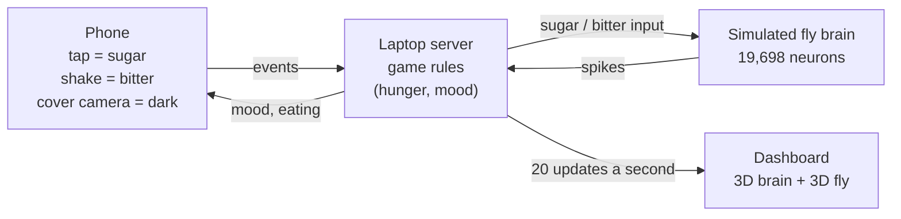

# Fly Tamagotchi

**A virtual pet fruit fly with a simulated real fly brain inside.**
You feed it from your phone. It only eats if its simulated feeding neuron fires.


## What is this?

Scientists have mapped every neuron and every connection in the brain of a fruit fly
(*Drosophila melanogaster*). This map is called a **connectome**. The fly brain has about
140,000 neurons and millions of connections.

Fly Tamagotchi turns that map into a pet:

- A computer **simulates the fly's brain**, neuron by neuron, in real time.
- Your **phone is the controller**: tap it to give the fly sugar, shake it to give it
  something bitter, or cover the camera to make it dark.
- The **laptop shows the fly and its brain**: you can watch neurons light up and see the fly
  react.

**The fly is not scripted.** Nobody wrote "if sugar, then eat". The fly eats only when its
feeding neuron (called **MN9**) actually fires in the simulated brain. When you give it
sugar and something bitter at the same time, it eats less, and that also comes from
the brain's wiring, not from a rule.

## How to play

| On your phone | What the fly tastes or feels | What usually happens |
|---|---|---|
| **Tap** the big sugar button | Sugar | Sugar-sensing neurons fire, the signal travels through the brain to MN9, and the fly eats |
| **Shake** the phone | Something bitter | Bitter-sensing neurons fire; the fly looks disgusted and does not eat |
| Tap **and** shake | Sugar and bitter together | The brain mixes both signals; MN9 barely fires, so the fly mostly refuses |
| **Cover the camera** | Darkness | The fly rests and gets its energy back |

Like a Tamagotchi, the fly has moods: **hunger**, **happiness** and **energy**. It gets hungry
over time. Leave it starving for too long and it faints (press **Revive** to bring it back).


## What you see on the laptop

### The fly

A realistic 3D fruit fly, based on a scientific model built from a scan of a real fly. It
moves its proboscis (its mouth), wings, legs and head to show what its brain is doing.
You can switch between side, top and close-up camera views. The scale bar is a true
1 millimetre.


| State | What it looks like | Who decides |
|---|---|---|
| **Eating** | Proboscis down in the sugar drop, pumping | The **brain** (MN9 fires) |
| **Disgusted** | Wings buzz, front legs rub its face | The **brain** (bitter neurons fire) |
| **Resting** | Lights dim, the fly settles | A **game rule** (it's dark) |
| **Fainted** | On its back, legs curled | A **game rule** (starving too long) |

The label next to the state always says whether the brain or a game rule is behind it.

### The brain


Every dot is one real neuron, drawn where it sits in the fly's head (seen from the front).

- **Blue-grey** dots are resting.
- **Purple** dots are being **stimulated**: your phone is feeding them sugar or bitter right now.
- **Orange** dots are **firing**.

Point at any dot to see its name from the FlyWire brain map, its chemical messenger and
its ID. Buttons at the top highlight the sugar neurons, the bitter neurons or MN9.

### Why it's doing that

Below the fly, live bars show how fast the sugar neurons, bitter neurons and MN9 are firing,
with the "eating line" (20 spikes per second) drawn on MN9, and a sentence explaining what's
happening in plain words. A chart shows the last 10 seconds. You can even press **Hear the
brain** to turn every spike into a sound, like the audio monitor in a neuroscience lab.

## How it works



1. Your phone sends an event (for example "sugar") to a small server on the laptop.
2. The server turns it into activity in the fly's taste neurons.
3. The brain simulation runs in 50-millisecond steps. Each neuron adds up the signals it
   receives from the neurons connected to it, and fires when it passes a threshold.
4. The server watches the feeding neuron MN9. If it fires at 20 spikes per second or more,
   the fly is eating.
5. Twenty times a second, the dashboard gets the latest spikes and draws the brain and the fly.

**The one link from the game into the brain:** a hungry fly gets a stronger sugar signal
than a full one. When the fly is full, its sugar signal becomes too weak for MN9 to pass the
eating line, so it stops eating on its own. Satiety comes out of the brain; there is no
"stop when full" rule.

## Is this real science?

The brain is as real as we could make it, with honest limits.

- **The wiring is real.** It comes from [FlyWire](https://flywire.ai), the complete map of an
  adult fruit fly brain (release 630: 127,400 neurons, about 14.7 million connections).
- **The brain model is a published one.** We re-built the model from
  [Shiu et al. 2024, *Nature*](https://github.com/philshiu/Drosophila_brain_model), which
  showed that this wiring alone predicts feeding behaviour. We use their exact settings and
  checked that we get the same answers: with sugar at 100 Hz, MN9 fires at 68.4 ± 4.6
  spikes/s in our model and 67.0 ± 6.7 in theirs.
- **It's tested against a control.** A "shuffled" brain with the same neurons and the same
  number of connections, randomly rewired, never eats. So the behaviour comes from the real
  wiring, not from chance.
- **For speed, the live game runs a part of the brain:** the 19,698 neurons that lie within 5
  connections of the taste neurons and MN9. It gives the same MN9 results as the full brain
  (84.2 vs 85.8 spikes/s for sugar).
- **The 3D fly** is the [flybody](https://github.com/TuragaLab/flybody) model (Vaxenburg et
  al. 2025, *Nature*). Its poses are drawn from the brain's output; it is not
  physics-simulated here.

**Limits.** The neurons are simplified ("leaky integrate-and-fire"). Connection strengths are
estimated from synapse counts, and whether a connection excites or inhibits is inferred from
predicted neurotransmitters. The wiring never changes, so the fly cannot learn. Light is not
wired into this brain: resting in the dark, hunger, happiness, energy and fainting are
**game rules**, and the dashboard labels them that way.

## Try it yourself

You need Python 3.11+, Node.js 22+ (for the tests), a laptop and, for the full experience, a
phone on the same network.

```bash
git clone https://github.com/ameerul-muminin/fly-tamagotchi.git
cd fly-tamagotchi
python -m venv .venv
.venv\Scripts\activate            # Windows; macOS/Linux: source .venv/bin/activate
pip install -r requirements.txt
python -m brain.download_data     # the brain map, about 130 MB
python -m brain.neuron_groups     # finds the sugar, bitter and MN9 neurons
python -m server.fly_model        # builds the 3D fly, about 140 MB download, 2 minutes
python -m server                  # starts the game
```

Then open <http://localhost:8000/> on the laptop and scan the QR code with your phone.
Shaking and the camera need HTTPS on an iPhone: run `ngrok http 8000` in a second terminal
and the QR code switches to the secure address by itself (details below).

No phone yet? Watch a recorded session:
<http://localhost:8000/dashboard/?replay=samples/session.jsonl&loop=1>

Want the whole story? [`reports/FLY_TAMAGOTCHI_GUIDE.pdf`](reports/FLY_TAMAGOTCHI_GUIDE.pdf)
explains the science and every part of the code.

## Credits

- **Brain map:** FlyWire Consortium (Dorkenwald et al. 2024, Schlegel et al. 2024, *Nature*).
- **Brain model:** Shiu et al. 2024, *Nature*,
  [philshiu/Drosophila_brain_model](https://github.com/philshiu/Drosophila_brain_model).
- **3D fly:** Vaxenburg et al. 2025, *Nature*,
  [TuragaLab/flybody](https://github.com/TuragaLab/flybody) (Apache-2.0). Downloaded and
  converted on your machine; not included in this repository.
- **3D graphics:** [three.js](https://threejs.org).

## License

The code in this repository is under the [MIT License](LICENSE). The data it downloads
(FlyWire connectome, the Shiu et al. model files, the flybody fly) keeps its own license
and is not included here.

---

## For developers

`PLAN.md` has the full project plan and `CLAUDE.md` the working rules. Each phase has a plan
and a report with its test results in `reports/`.

### Setup

```bash
python -m venv .venv
.venv\Scripts\activate            # Windows; macOS/Linux: source .venv/bin/activate
pip install -r requirements.txt
python -m brain.download_data     # ~130 MB into data/, checksums verified
python -m brain.neuron_groups     # writes data/neuron_groups.json
python -m server.fly_model        # the dashboard's 3D fly (flybody): ~140 MB download, 2 min
pytest -q                          # a few minutes; includes full-brain and reduced-circuit validation
python -m brain.validate           # Phase 1 report (full brain), writes data/validation_results.json
python -m brain.validate_reduced   # Phase 2 table: reduced vs full brain, shuffles, speed
```

### Run the server (Phase 2)

```bash
python -m server                   # reduced brain (real time) on port 8000
python -m server --brain full      # full brain (about 65 ms per 50 ms chunk, not real time)
python -m server.fake_phone --spawn   # starts a server, sends fake phone events, prints spike counts
```

WebSockets: `/ws/phone` and `/ws/dashboard`. Every message is documented in
`reports/MESSAGE_FORMAT.md`, and every server setting is in `server/config.py`.

### Connect an iPhone (Phase 3)

Open `http://localhost:8000/` on the laptop. The dashboard's "Connect a phone" panel shows a
QR code for the phone page (`/phone/`). Tap = sugar, shake = bitter, cover the camera = dark.

iOS Safari only allows shake and camera on **HTTPS** pages. Tapping works over plain HTTP.
Pick one of these:

```bash
# A: ngrok (easiest). The dashboard QR code picks up the tunnel automatically.
python -m server
ngrok http 8000

# B: mkcert certificate for the laptop's LAN IP (install mkcert's root CA on the iPhone
#    and trust it under Settings > General > About > Certificate Trust Settings)
mkcert -install && mkcert 192.168.1.50      # use your laptop's IP
python -m server --certfile 192.168.1.50.pem --keyfile 192.168.1.50-key.pem
```

On the phone, tap **Enable shake + camera** once. iOS asks for motion and camera
permission. Phone tunables (shake threshold, camera rate, vibration…) are in
`PhoneConfig` in `server/config.py`.

Checks without a phone: `python -m server.phone_page_check --spawn` runs the real phone
logic (`web/phone/controller.js`) in Node with a mock tap, mock shake and mock camera
frames against the reduced brain. It needs Node.js 22+, which `pytest -q` also needs.

### Dashboard (Phase 4)

Start the server, then open <http://localhost:8000/dashboard/> on the laptop.

- **Replay** a recorded session instead of the live brain:
  <http://localhost:8000/dashboard/?replay=samples/session.jsonl> (add `&speed=4`, `&loop=1`).
- **Record** a new sample (real reduced-brain output): `python -m server.record_session --spawn`
- **Validate** in headless Chrome (replay + live): `python -m server.validate_dashboard`
- **JS tests**: `cd web/dashboard && npm test` (also run by `pytest`; needs Node.js)

three.js loads from `cdn.jsdelivr.net` (pinned to 0.170.0), so the 3D view needs internet access.
Display settings are in `web/dashboard/config.js`.

What's on the page:

- **The brain** (`brain3d.js`, front view): every neuron with a position in the FlyWire
  annotation table (139,248; `pos_x/y/z`, 4×4×40 nm voxels) is drawn, so the whole brain's
  shape shows. Only the simulated ones can light up: 17,101 of the 19,698 reduced-brain
  neurons (v630 IDs unchanged in v783). Colors: resting, *stimulated* (the phone input is
  driving that neuron's group right now) and *firing* (a spike in a recent tick). The chips
  (All / Sugar / Bitter / MN9) highlight one group. Hover a neuron for its FlyWire cell type,
  side, transmitter and ID. L / R are placed from the annotation table's `side` column.
  Drag to turn, double-click to reset.
- **The fly** (`fly_model3d.js`): the flybody fruit fly (Vaxenburg et al. 2025, Nature;
  `TuragaLab/flybody`, Apache-2.0), posed through its own joints, with Side / Top / Follow
  cameras and a true 1 mm scale bar. It extends its proboscis into the food and pumps only
  while MN9 fires (the pump rate follows the MN9 rate), grooms and buzzes its wings when
  bitter neurons fire, and rests in the dark. The poses live in `fly_motion.js`; the state
  comes from the brain (see `state.js`). Build it once with `python -m server.fly_model`
  (`data/fly_model/fly.glb`, 132k triangles, and `fly_low.glb`, 36k, no bristles).
  Quality is automatic: the full model with shadows and reflections on a GPU, the light model
  on a software renderer. Force it with `?quality=high` or `?quality=low`. Without the built
  model the simpler primitive fly (`fly3d.js`) is shown; without three.js, a 2D fly.
- **Why it's doing that**: live meters for the sugar and bitter neurons and MN9, with the
  server's eating threshold drawn on the MN9 meter, and a sentence explaining the current state.
- **Gulps**: how many times the brain started eating this session.
- **Hear the brain** (`sound.js`): every spike becomes a sound, like a lab's audio monitor.
  MN9 spikes are deep thumps, sugar neurons bright plucks, bitter neurons a low buzz, the rest
  soft clicks, plus a gulp and a "blech" when eating or disgust starts. A silent brain is silent.

### Game rules (Phase 5)

The mood bars are live. Every value is in `server/config.py` `GameRules`; the rules are in
`server/game.py`.

- **Hunger** rises with time (empty to starving in 4 min) and falls only while the brain's
  eating readout is on (MN9 ≥ 20 Hz).
- **Happiness** rises while eating; bitter-neuron spikes, starving and light while tired cost
  some.
- **Energy** drains in the light and refills in the dark (light level below 0.15, one
  threshold for server, phone and dashboard).
- **Fainting**: 30 s at 100 % hunger and the fly faints; press **Revive** on the dashboard.
- **Hunger scales the sugar signal** (150 Hz × (0.2 + 0.8 × hunger)). A full fly's sugar
  signal is too weak for MN9 to pass the eating line, so it stops eating by itself, through
  the brain. Turn it off with `hunger_scales_sugar=False`.

Validate on the real brain: `python -m server.validate_game` (5 seeds, about 4 minutes).

### Data

| What | Source | Version |
|---|---|---|
| Neurons + connectivity | `philshiu/Drosophila_brain_model` @ `91bdd1e`: `2023_03_23_completeness_630_final.csv`, `2023_03_23_connectivity_630_final.parquet` | **FlyWire release 630** (127,400 neurons, 14,687,178 connections): the release the Shiu et al. paper and code use |
| Sugar GRNs, bitter GRNs, MN9 IDs | Parsed from that repo's `figures.ipynb` (Fig 3A and Fig 2 cells) | v630 root IDs |
| Photoreceptor candidates (R7, R8) | `flyconnectome/flywire_annotations` @ `8587524`, `Supplemental_file1_neuron_annotations.tsv` | Annotations are v783; only IDs unchanged in v630 are used |
| Reference results for the sanity check | Repo `results/example/sugarR_100Hz.parquet` | v630 |

All files are pinned by commit and sha256 in `brain/config.py`.

### Brain model

A NumPy/SciPy reimplementation of the Shiu et al. 2024 leaky integrate-and-fire model.
All parameters come from the repo's `model.py` and are listed, with citations, in
`brain/config.py`. The time step (0.1 ms) is Brian2's default, because the repo never sets it.

- Weight = synapse count × sign (`Excitatory x Connectivity` column) × 0.275 mV.
- Stimulated neurons get Poisson input that adds 68.75 mV to v and have no refractory period.
- Each step follows Brian2's schedule. Synaptic or Poisson input that arrives while a
  neuron is refractory is discarded, matching Brian2's conditional-write rule for
  `(unless refractory)` variables.
- On a small test network the simulator gives exactly the same spikes as the repo's own
  Brian2 code (`tests/fixtures/`).

### Phase 1 results (5 seeds, 1 s trials, readout MN9 `720575940660219265`)

| Condition | Real brain | Shuffled brain |
|---|---|---|
| Sugar 150 Hz | 85.8 ± 5.8 Hz | 0.0 ± 0.0 Hz |
| Sugar 150 Hz + bitter 150 Hz | 9.6 ± 3.2 Hz | 0.0 ± 0.0 Hz |
| Bitter 150 Hz | 0.0 ± 0.0 Hz | 0.0 ± 0.0 Hz |

- Sanity check, sugar at 100 Hz: our MN9 rate is 68.4 ± 4.6 Hz, the repo's is 67.0 ± 6.7 Hz (30 trials).
- Speed (Phase 1, NumPy): about 112 ms of wall time per 50 ms simulated, about 2.2× slower than real time. Phase 2 fixes this (below).

### Phase 2: reduced circuit (seeds 0–4, 1 s trials, 150 Hz inputs)

The server runs a reduced circuit: every neuron on a path of at most 5 connections from a
sugar or bitter GRN to an MN9. That is 19,698 neurons and 2,415,250 connections.
The full brain is still available with `--brain full`.

| Condition | Full brain | Reduced circuit | Shuffled reduced (5 shuffles) |
|---|---|---|---|
| Sugar | 85.8 ± 5.8 Hz | 84.2 ± 4.9 Hz (−1.9%) | 0.0 Hz |
| Sugar + bitter | 9.6 ± 3.2 Hz | 9.6 ± 3.2 Hz (0.0%) | 0.0 Hz |
| Bitter | 0.0 Hz | 0.0 Hz | 0.0 Hz |

Speed with the numba kernel:

| Brain | Mean per 50 ms chunk | 95th percentile |
|---|---|---|
| Reduced | 8.4 ms | 12.1 ms |
| Full | 66.7 ms | 97.4 ms |

The simulator has two backends that give identical spikes: NumPy, and numba (the default
when installed).

### Known limitations

- Background noise is implemented but **off by default**. Every noise level tested either
  stayed invisible or eventually ignited a self-sustained runaway state, in the reduced
  circuit and in the full brain. See `reports/PHASE_2_REPORT.md`.

- Only about 21% of annotated R7/R8 photoreceptors have v630 IDs, mostly on the right
  side. Matching the rest would need the FlyWire CAVE API.
- The repo's `sugarR.parquet` example was run at 200 Hz, not the 150 Hz default in
  `model.py`. The sugar neurons in it fire at about 197 Hz.
