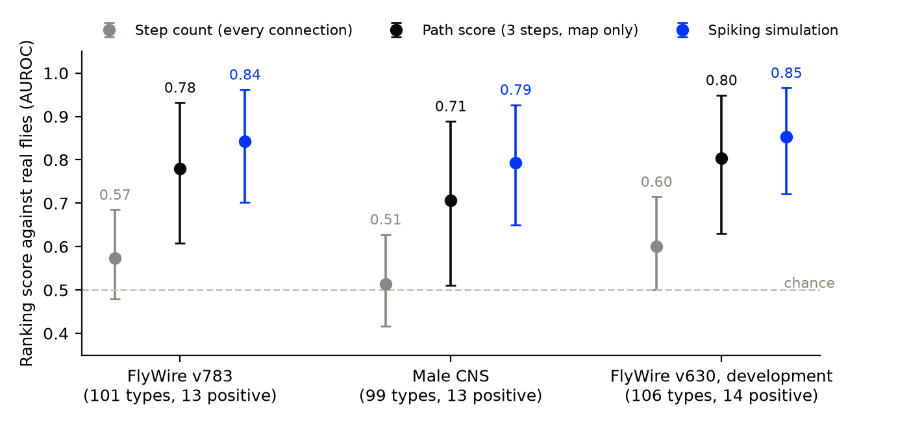
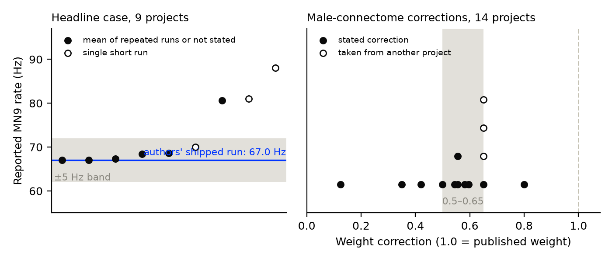

# How much of a fly's feeding behaviour is written in its wiring? A map-only baseline for a whole-brain simulation, and a census of its public re-runs

**Draft v1 (revised after fact-check), 10 October 2026. Not peer-reviewed. Not yet released.**

**Authors:** [to be confirmed by Agrim], Terramind

> **Editor's notes (remove before release)**
> - Author names, affiliation line and contact address are not on file and are left open.
> - Section 2.2 states plainly that the extraction passes and audits were done by AI agents. Whether to add a fuller statement on how the work was produced is Agrim's decision; many venues require one.
> - Items marked **[pending]** wait on the steps listed in `DUE_DILIGENCE.md`.
> - References 24 and 25 were added late and are out of citation order; renumber at typesetting.

---

## Abstract

Shiu et al. (2024) showed that a simple spiking simulation built from the fruit fly's wiring map predicts which neurons make a real fly extend its proboscis [1]. We ask two follow-up questions with public data and open code. First, how much of that prediction is already present in the wiring map before any simulation is run? In a test whose rules were fixed in advance (with the caveats in Section 2.2), we score a map-only "path score" (signed connection weights followed for three steps to the feeding motor neuron MN9) against the paper's real-fly screen of 106 cell types. The path score ranks cell types above chance on a later version of the same female connectome (AUROC 0.78) and, narrowly, on a second, male connectome (0.71). The spiking simulation is measurably better on the female connectome (0.84; paired difference 0.06, 95% interval 0.02–0.12), and it is better on 18 harder cases in which a cell type is silenced (13 correct against 8). Second, what do public re-runs of the simulation report? In a census of 97 code repositories that state a firing rate for MN9, 72 report their own measurement. Of the projects that ran the paper's headline case, 6 report a rate within 5 Hz of the 67.0 Hz in the authors' shipped example run (6 of 8 as first coded, 6 of 9 under a consistent coding), which falls short of the 80% we had set as the bar for agreement. Six of seven that report a shuffled-wiring control found MN9 silent. For the male connectome there is no agreed correction to the synaptic weight: 14 projects state one, from 0.124 to 0.8 of the published value. The picture is of a wiring map that is informative on its own, a simulation that adds measurable value on top of it, and a published computational result that many people have run for themselves.

## 1. Introduction

The adult fruit fly brain has been mapped at the level of individual synapses [2, 3]. Shiu et al. turned that map into a leaky integrate-and-fire simulation with a single free parameter and tested it against experiments [1]. In the best-known test, activating sugar-sensing taste neurons in the simulation drives the motor neuron MN9, which extends the proboscis; in a screen of 106 cell types in the fly's feeding region, the simulation's predictions agreed with what real flies did in most cases.

A second connectome, of the male central nervous system, was described in a 2025 preprint and published in 2026 [4, 24]. In September 2026 a large number of people posted code that re-runs the Shiu model: of the 72 projects in our census, 64 made their first commit that month. That makes two questions timely.

**How much is in the map, and how much does the simulation add?** Writing about graph-traversal and signal-cascade approaches, Shiu et al. note that "because these models measure traversal length, rather than a measure of activation, they are unlikely to be useful for predicting what neurons contribute most to a given circuit" [1]. Their Supplementary Table 3 lists a "Shortest Path" value next to the simulation's output for each cell type, but the paper does not score a map-only predictor against the real-fly results. We do that here, to quantify both parts: what the wiring alone tells you, and what simulating it adds.

**What do public re-runs report?** We read what a defined set of those projects report for the paper's headline quantities and compare them with the paper.

We wrote our tests and decision rules down before running them (Section 2.2), and we report every pre-registered verdict, including one where our own expectation was wrong.

## 2. Methods

### 2.1 Data and model

- **Connectomes.** FlyWire v630 (the version used in [1]; 127,400 neurons in the model) and FlyWire v783 (138,639 neurons in the model) [2, 3]; the male CNS v1.0 [4] (165,122 neurons and 25,563,096 connections in our conversion). For the male connectome each neuron's sign comes from its top predicted transmitter; 14,365 neurons with an unclear transmitter and 502 with none were treated as excitatory.
- **Model.** The model of [1], built with the authors' code [5] (commit `91bdd1e`, MIT licence) and the published parameters. For the screens we used our own runner around that model (it builds the network once and restores it between trials) on Brian 2 version 2.7.1 [6]. For the male connectome the synaptic weight is multiplied by 0.561, the inverse of the type-matched ratio of synapse counts between the two datasets that we measured (1.78); the preprint of the male CNS paper reports "a scaling factor of 0.581 which we apply to all male CNS edge weights for cross-dataset comparisons" [24] **[pending: check the published version [4] for the same figure]**.
- **Real-fly results.** Supplementary Table 3 of [1]: for 106 cell types, the fraction of flies that extended the proboscis when that type was activated with light. A type is positive if the fraction is above zero (14 of 106). For silencing, Supplementary Tables 2 and 5 of [1].
- **Simulation outputs.** For each cell type, the mean firing rate of MN9 over 30 one-second trials with that type activated at 50 Hz. On FlyWire v630 with the authors' own neuron lists, our runs make the same fires/does-not-fire call as the paper's table for all 106 types, the rates correlate at r = 0.9986, and the score against real flies is the paper's (10 hits, 1 false alarm, 4 misses). For the v630 row of Section 3.2 we use the paper's published rates.

### 2.2 Pre-registration, and what was already known

The predictors, test sets, statistics and decision rules were written to a plan file and committed to version control (`PLAN3.md`, commit `abb98a0`) before any map-only predictor was scored on the test sets and before the census extraction. We state four things that were already in hand at that point:

- **The simulation runs** on both test sets existed and had been scored against the same real-fly screen in an earlier pre-registered experiment (Section 4).
- **A pilot** on FlyWire v630 had compared eight variants of the path score; we chose "signed, three steps" from it. The v630 result is therefore reported as development data.
- **The paper's own "Shortest Path" column** had been scored against the screen on v630 (AUROC 0.771).
- **A draft census** from the search step had shown its rough pattern (FlyWire v630 values near 67 Hz; male-connectome corrections spread between about 0.15 and 0.65) before the census rules R1–R3 were fixed.

The predictors were fixed in the plan's text; the code implementing them was committed with the results. Analyses added later are labelled exploratory.

**Who did the checking.** The two extraction passes of the census, the independent re-computation of the results, and a blind fact-check of this draft were each carried out by a separate run of an AI language-model agent. The two extraction passes could not see each other's output. The re-computation worked from the raw files with its own code and reproduced every point estimate (it reported intervals within 0.006 of ours). The fact-checks read our results files as well as the raw data. None of these is an independent human review. Numbers added after the re-computation were recomputed in two later fact-check passes.

### 2.3 Predictors

| | Predictor | Definition |
|---|---|---|
| P1 | Step count | Fewest synaptic steps from any neuron of the cell type to MN9, counting every listed connection. |
| P2 | Path score | Place 1 on every neuron of the type; multiply by the signed connection matrix and clip negatives to zero, three times; sum what arrives at MN9 over the three steps. |
| P3 | Simulation | Mean MN9 firing rate in the spiking simulation (Section 2.1). |

P2 is itself a very simple model: a rectified linear calculation on the map. It has no spiking dynamics, no time constants and no free parameter beyond the number of steps.

### 2.4 Test sets

- **C2, FlyWire v783:** 101 cell types (13 positive), each mapped to all neurons of its annotated type.
- **C1, male CNS:** 99 cell types (13 positive), mapped by matching type names; MN9 on the left side is the readout because the right-side neuron is flagged as hard to trace in the dataset.
- **C3, silencing:** 18 cases (9 cell types under sugar, 9 under water; 11 distinct types) in which real flies were tested with that type silenced. The test is computed on FlyWire v630, the development connectome. The simulation's prediction is the paper's published ratio of MN9 firing with and without the type (required if below 0.8, the paper's rule). The map-only prediction applies the same rule to P2 computed with and without the type's outgoing connections. One planned type (Zorro) is absent from the authors' cell-type file and was excluded under the pre-registered rule.

The real-fly labels are the same in every set. C1 and C2 test other connectomes and a broader choice of neurons against one real-fly screen; they are not new fly experiments. FlyWire v783 is a later version of the same female brain as v630: 52 of its 101 types use identical neuron lists, and the path scores on the two have a rank correlation of 0.92. Only the male CNS is a new individual.

### 2.5 Statistics

Ranking quality is the area under the ROC curve (AUROC; 0.5 is chance), with ties counted as half. Intervals are 95% bootstrap intervals over cell types (10,000 resamples, seed 0). Differences between predictors use a paired bootstrap. Decision rules:

- **M1** (the map alone carries signal): supported if the lower end of P2's interval is above 0.5 on both C1 and C2.
- **M2** (the map-only score cannot be told apart from the simulation on this screen): supported if the interval of P3 − P2 includes zero and the difference is at most 0.10 on both sets; not supported if the interval lies wholly above zero on either.
- **M3** (the simulation does better on silencing): supported if the simulation is correct on at least three more cases than P2.

### 2.6 Census

**Design.** A retrospective census of public repositories, in the spirit of repository-mining studies of research code [7, 8] and distinct from prospective many-analysts studies [9, 10]. We executed no third-party code.

**Frame.** The 97 GitHub repositories whose README contained a line with both "MN9" and a value in Hz in a search snapshot taken on 10 October 2026. The search covers an unknown share of public GitHub (a rough estimate is half or less), so counts are lower bounds.

**Inclusion.** A repository is included if its README reports an MN9 firing rate that the project itself measured, from a Shiu-type model on a fly connectome, under sugar taste-neuron activation.

**Extraction.** Two passes worked independently from the same README copies with a fixed codebook (connectome, stimulus, rate, reported MN9 rate, reference value, outcome under shuffled wiring, male-connectome weight correction, verbatim quote for every number). Disagreements were resolved by us from the quoted lines and logged.

**Outcomes (as pre-registered).**
- **R1:** among included projects that state FlyWire v630 and 100 Hz, or state that they reproduce the paper's shipped sugar result, supported if at least 80% report MN9 within 5 Hz of 67.0 Hz; not supported if fewer than 50% do; fewer than five such projects is "not assessable".
- **R2:** among projects reporting a shuffled or rewired control, supported if at least 80% report MN9 silent or reduced by at least 90%; not supported if fewer than 50% do; fewer than five is "not assessable".
- **R3** ("there is no agreed correction for the male connectome"): among projects stating a weight correction, supported if the largest is at least twice the smallest; not supported if it is within 1.25 times; fewer than four is "not assessable".

Anything between "supported" and "not supported" is inconclusive. The reference value of 67.0 Hz is the mean MN9 rate in the example run shipped with the authors' code [5]; the paper's Supplementary Table 1A lists 65.7 Hz for the same condition. The plan called 67.0 Hz "the paper's" value, which was imprecise.

## 3. Results

### 3.1 The wiring map alone carries real signal

**Figure 1. Ranking of cell types against the real-fly screen.** Points are AUROC; bars are 95% bootstrap intervals. Step count here counts every listed connection (see Section 3.4). The v630 panel is development data.

On both test sets the path score ranks the cell types that work in real flies above those that do not: AUROC 0.780 (0.608–0.932) on FlyWire v783 and 0.707 (0.511–0.889) on the male CNS. **M1 is supported.** On the male CNS, the only new individual, it holds narrowly: the lower bound is 0.511 at the pre-registered seed and between 0.506 and 0.513 across twelve seeds. The pre-registered sensitivity variants score at least as well there (0.731 with two steps, 0.730 with four, 0.754 excitatory-only), and 0.706, 0.780 and 0.754 on v783.

Many path scores are exactly zero (69 of 101 types on v783; 56 of 99 on the male CNS), so much of the ranking is a split between types with any signed route to MN9 within three steps and types with none.

Step count over every listed connection is not informative (0.573 and 0.513; both intervals include 0.5), because almost every cell type is within two steps of MN9. The simulation is ahead of it by 0.270 (0.121–0.411) on v783 and 0.280 (0.135–0.428) on the male CNS.

### 3.2 The simulation adds measurable value

| Set | Path score (P2) | Simulation (P3) | P3 − P2 |
|---|---|---|---|
| FlyWire v783 | 0.780 (0.608–0.932) | 0.843 (0.702–0.962) | 0.063 (0.019–0.119) |
| Male CNS, weight ×0.561 | 0.707 (0.511–0.889) | 0.793 (0.650–0.927) | 0.086 (−0.060–0.236) |
| FlyWire v630 (development) | 0.804 (0.631–0.949) | 0.853 (0.721–0.966) | 0.050 (0.012–0.096) |

On FlyWire v783 the simulation is ahead and the interval of the difference excludes zero. **M2 is not supported:** this test can distinguish the two, in the simulation's favour. We had expected the opposite (Section 4). On the male CNS at the pre-registered weight the difference is of similar size but its interval includes zero. With the other weights we ran on the male CNS, the simulation is ahead by 0.116 (0.022–0.245) at ×0.698 and by 0.063 (−0.026–0.199) at ×1.0.

The two predictors mostly agree about which types do anything: the path score ranks the simulation's own fires/does-not-fire calls at 0.963 on v783 and 0.870 on the male CNS.

*Exploratory.* On v783, the four real positives to which the path score assigns zero are also silent in the simulation. The difference lies in the negatives: one negative type fires in the simulation, while 23 have a non-zero path score. This suggests the simulation's advantage on this screen is selectivity. It treats any non-zero path score as a call, which was not a pre-registered threshold.

### 3.3 The simulation is better on silencing

| Predictor | Correct of 18 |
|---|---|
| Simulation (published ratios, 20% rule) | 13 |
| Path score, three steps | 8 |

**M3 is supported.** The two predictors disagree on five cases and the simulation is right on all five (exact sign test, two-sided p = 0.06). The path score labels only four cases "required", and its 8 of 18 equals what always answering "not required" would score. With four steps (sensitivity only) the path score reaches 10 of 18.

The verdict held under the alternative labellings we tried. Zorro's neurons are listed elsewhere in the supplement; including them gives 15 of 20 against 9 of 20. Scoring Fdg under sugar as required gives 12 against 7; scoring FMIn as not required gives 14 against 9; scoring one disputed water case against the simulation gives it 12 of 18.

### 3.4 A note on step counts (exploratory)

Our step counts match the "Shortest Path" column of [1] for only 56 of 106 types when every listed connection counts. Counting only connections of five or more synapses reproduces the column for 104 of 106 types. With that threshold, step count ranks the cell types at 0.761; the published column gives 0.771. On this one connectome, then, step count is informative once weak connections are left out; we have not tested that on v783 or the male CNS. The supplement's legend defines the column as "the minimum number of synapses separating neurons in the split-GAL4 and MN9" and states no threshold, so the five-synapse reading is our inference **[pending: confirm with the authors]**.

### 3.5 The census

**Figure 2. What public projects report in their READMEs.** Left: MN9 firing rate for the paper's headline case (nine projects under the consistent coding; eight as first coded); the line is the authors' shipped example run (67.0 Hz) and the band is ±5 Hz around it; open circles are single short runs. Right: weight corrections stated for the male connectome, as a fraction of the published weight; open circles are values taken from another project; the band 0.5–0.65 was chosen after seeing the data.

**Scale and agreement between passes.** Of the 97 repositories in the frame, 72 were included and 25 excluded. The two passes agreed on inclusion for 90 of 97; the seven disagreements were all resolved towards exclusion. Among the 72, the reported MN9 value matched as written in 62 and on the first listed value in all 72. Of the 72, 64 have a first commit in September 2026 and 6 in October. The headline number is on FlyWire v783 in 33 projects, the male CNS in 18 and FlyWire v630 in 13. These projects are not independent of one another: many share code or sources, they appeared within weeks of each other, and many look AI-assisted.

**R1, the headline case: inconclusive.** As first coded, 8 projects state FlyWire v630 and 100 Hz, and 6 report MN9 within 5 Hz of 67.0 Hz (75%; the bar was 80%). Two projects name the v630 data file without writing the version next to the number, and only one of them had been counted; counting both gives 6 of 9 (67%), counting neither gives 6 of 7. The values are 67.0, 67.1, 67.3, 68.4, 68.6, 70, 80.6, 81.0 and 88. The same six fall within 5 Hz of the 65.7 Hz in the paper's Supplementary Table 1A. The three outside the band are all higher, and three of the nine (70, 81.0 and 88) are single short runs by their authors' own description. Our own run gives 67.5 Hz.

The rule's second clause ("or state that they reproduce the paper's shipped sugar result") was not defined tightly enough in advance. Adding the projects that compare their own number with 67.0 Hz gives 8 of 11 (73%), also inconclusive. Broader readings that count every claim of reproduction give lower shares but compare unlike settings; we do not report them as results.

**R2, shuffled wiring: supported.** Seven projects report what happens to MN9 when the wiring is shuffled or rewired; six report it silent and the seventh reports a graded loss under partial rewiring. One of the six reports MN9 abolished under rewiring and reduced from 41 Hz to a median of 3 Hz under a weight shuffle. The seven span different connectomes and settings. One further project says only that the simulated fly "does not feed" with shuffled wiring, without a rate; had we counted it as not silent, the result would be 6 of 8 (75%).

**R3, the male connectome: supported; there is no agreed correction.** Fourteen projects state a weight correction, from 0.124 to 0.8 of the published value (a 6.5-fold range). The verdict rests on the extremes: without the lowest and highest values the largest is 1.86 times the smallest, which would not meet the bar. The values were tuned to different targets (for example whole-brain firing rates, or the point where activity stops sustaining itself).

Within that spread there is a cluster: ten of the fourteen lie between 0.5 and 0.65 (five of them exactly on the edges of that range, which we chose after seeing the data), and the median is 0.57, close to the 0.581 scaling in [24] and to our 0.561. These are not ten separate results. Four values of 0.65 trace to a single project [11]; two values of 0.556 come from synapse-count arithmetic and not from tuning a response; one value (0.5) comes from a model with an added mechanism. About four look like separate calibrations (0.545, 0.582, 0.596 and 0.65). Two excluded projects also state corrections (0.455 and 0.5). Separately, one project says it used the published weight unchanged on the male connectome and three more simply state the published value there; two say that no single factor works.

**Other observations.** One included project is doubtful (its own engine on a small extract, with no claim to use the paper's parameters), and one excluded project very probably ran the headline case (68.0 Hz) but its table does not name MN9. Outside the headline case, settings differ too much to compare: on FlyWire v783 at 100 Hz, nine projects report MN9 rates from 15.7 to 190 Hz with different or unstated taste-neuron sets.

## 4. What we tried and changed along the way

This work began as a different question: does the Shiu model, unchanged, transfer to the male connectome?

1. **We reproduced the original.** With the authors' code and data, MN9 fired at 67.5 Hz against 67.0 Hz in their shipped result; with shuffled weights it never fired in 100 runs.
2. **The model ran away on the male connectome.** At the published weight, activity spread to about 30 times more neurons. We traced this to the higher synapse counts in the male dataset.
3. **A first audit found errors in our write-up,** including a readout neuron that the dataset flags as hard to trace and wording that overstated the result. We corrected them.
4. **Others had already done most of it.** Berg et al. report the synapse-count difference [24]; the flymsg project had run the model on the male connectome and found a working weight [12]; Fugsukjit had benchmarked a re-implementation against the paper's tables on FlyWire [13]; the Fly.exe project had scored a male-connectome model against the same real-fly screen on a sub-network [14]; Cho's flybench is a benchmark of pre-registered tasks for such models [15]. Our density-matched male model gave 8 hits and 3 false alarms on 99 types, consistent with those results, but it failed our own pre-registered robustness check, and a second audit showed that one of its hits and some of its false alarms rested on a handful of spikes. We did not pursue it as a finding.
5. **We changed the question, and our expectation was wrong.** A pilot suggested that a map-only score did about as well as the simulation, and we expected the confirmation test to be unable to separate them. It separated them, in the simulation's favour (Section 3.2).
6. **A third audit corrected us again.** In our first write-up of these results, two statements ran ahead of the data (we had described the male-connectome corrections as independently arrived at, and both test sets as new), one count was wrong (10 cell types for 11) and one check had dropped a row. A fact-check of this draft then found further overstatements, including the word "independent" for the census projects. All are corrected here.

## 5. Related work

- **Map-only predictors.** Linear and graph-based summaries of connectome influence exist [16, 17, 18], and the flywire-fly-lab project compares wiring metrics with the simulation's own knockout effects [19]. Fly.exe includes a control in which connections are averaged within cell types, still run as a spiking simulation [14]. The flyconn project, first published on 29 September 2026, enumerates signed one-to-three-step routes and tabulates their net sign beside simulated silencing effects [25]. In searches up to 10 October 2026 (GitHub repositories and READMEs, bioRxiv titles and abstracts from 1 September, arXiv, OpenAlex and Europe PMC; Zenodo's search failed, and Google Scholar, SSRN and OSF were not searched) we found no scoring of a map-only predictor against the real-fly screen alongside the simulation. We have not read flyconn's code **[pending: repeat the search on the day of release]**.
- **Perturbation studies of the model.** Random and targeted removal of neurons or connections has been examined by several groups, for example An [20].
- **Reproducibility studies.** Many-analysts studies [9, 10] and repository-scale audits of research code [7, 8] are the methodological precedents for Section 2.6. Curated lists of fly-brain projects exist but do not extract or compare reported numbers. In the same searches we found no census of re-runs of this model **[pending: repeat the search on the day of release]**.

## 6. Limitations

- **One real-fly screen.** All ranking results rest on 13 or 14 positive cell types. Intervals are wide.
- **Some of the screen's positives were known beforehand.** Ten of the 14 positive types carry a note in Supplementary Table 3 pointing to earlier reports that activating them elicits proboscis extension [21, 22, 23]. For the other four we found no earlier report. The earlier papers scored proboscis extension in general, while the screen scored a specific movement with new flies. We relied on the table's notes and on a reading of the earlier papers' source data that we have not repeated ourselves.
- **Base rate.** About 87% of types are negative, so accuracy is uninformative here; we report ranking quality instead.
- **Only the male CNS is a new individual,** and there M1 holds narrowly and M2's difference is not resolved.
- **The path score is a model too,** if a very simple one, and its form was chosen on FlyWire v630.
- **The simulation outputs had been scored before** the plan for this test was written (Section 2.2).
- **Silencing set.** Eighteen cases over 11 cell types, five discordant between the predictors, with the simulation's ratios taken from the paper and not re-run by us.
- **Census.** README text only; self-reported numbers; no third-party code executed; projects are not independent of one another; coverage of GitHub is unknown; R1 rests on eight or nine projects and R2 on seven; the census rules were written after a rough view of the data; first-commit dates come from one automated pull of the GitHub API.
- **Fly, sex and data pipeline are confounded** in any comparison between the two connectomes.

## 7. Data and code availability

All plans, code, result files, the frozen census frame with README copies, both extraction passes and the resolved table are in the project repository **[pending: public URL and archive DOI]**. Third-party data are used under their own licences: the authors' model code (MIT) [5]; the male CNS (CC BY 4.0) [4]; FlyWire **[pending: licence confirmation for redistribution of derived tables]**.

## Acknowledgements

We thank the authors of [1] for releasing code and data that make this kind of check possible, and the people behind the public projects whose READMEs we read. Named projects were contacted before release **[pending]**.

## References

1. Shiu PK, Sterne GR, Spiller N et al. (2024). A Drosophila computational brain model reveals sensorimotor processing. *Nature* 634, 210–219. https://doi.org/10.1038/s41586-024-07763-9
2. Dorkenwald S, Matsliah A, Sterling AR et al. (2024). Neuronal wiring diagram of an adult brain. *Nature* 634, 124–138. https://doi.org/10.1038/s41586-024-07558-y
3. Schlegel P, Yin Y, Bates AS et al. (2024). Whole-brain annotation and multi-connectome cell typing of Drosophila. *Nature* 634, 139–152. https://doi.org/10.1038/s41586-024-07686-5
4. Berg S, Beckett IR, Costa M et al. (2026). Sexual dimorphism in the complete Drosophila male central nervous system connectome. *Cell* 189, 5504–5526.e15. https://doi.org/10.1016/j.cell.2026.08.015
5. Shiu P, Spiller N. Drosophila_brain_model (code), commit `91bdd1e`. https://github.com/philshiu/Drosophila_brain_model
6. Stimberg M, Brette R, Goodman DFM (2019). Brian 2, an intuitive and efficient neural simulator. *eLife* 8, e47314. https://doi.org/10.7554/eLife.47314
7. Trisovic A, Lau MK, Pasquier T et al. (2022). A large-scale study on research code quality and execution. *Scientific Data* 9, 60. https://doi.org/10.1038/s41597-022-01143-6
8. Pimentel JF, Murta L, Braganholo V et al. (2019). A Large-Scale Study About Quality and Reproducibility of Jupyter Notebooks. *2019 IEEE/ACM 16th International Conference on Mining Software Repositories (MSR)*, 507–517. https://doi.org/10.1109/MSR.2019.00077
9. Silberzahn R, Uhlmann EL, Martin DP et al. (2018). Many Analysts, One Data Set: Making Transparent How Variations in Analytic Choices Affect Results. *Advances in Methods and Practices in Psychological Science* 1, 337–356. https://doi.org/10.1177/2515245917747646
10. Botvinik-Nezer R, Holzmeister F, Camerer CF et al. (2020). Variability in the analysis of a single neuroimaging dataset by many teams. *Nature* 582, 84–88. https://doi.org/10.1038/s41586-020-2314-9
11. blendi-remade. fly-brain-minecraft (code), commit `6cfa301`. https://github.com/blendi-remade/fly-brain-minecraft
12. Mazza G. flymsg (code), commit `cb3ed70`. https://github.com/gianlucamazza/flymsg
13. Fugsukjit V (2026). Benchmarking a whole-brain connectome model of Drosophila against experimental data: diagnosing knockout-prediction failures and a candidate excitatory role for the water-taste neuron Usnea. Zenodo, v1. https://doi.org/10.5281/zenodo.23025559 (concept DOI; code at https://github.com/vichienFF/flybrain-connectome-benchmark, commit `c4ef087`)
14. Ibtisam-Mohammad. Fly.exe (code), commit `cc25411`. https://github.com/Ibtisam-Mohammad/Fly.exe
15. Cho B (2026). flybench: a behavioural benchmark for whole-connectome simulations of Drosophila. Zenodo, v0.2.1. https://doi.org/10.5281/zenodo.22886374 (concept DOI; code at https://github.com/brandoncho369/flybench, commit `3052ce5`)
16. Bates AS, Phelps JS, Kim M et al. (2026). Distributed control circuits across a brain-and-cord connectome. *Nature* 656, 957–970. https://doi.org/10.1038/s41586-026-10735-w
17. Pospisil DA, Aragon MJ, Dorkenwald S et al. (2024). The fly connectome reveals a path to the effectome. *Nature* 634, 201–209. https://doi.org/10.1038/s41586-024-07982-0
18. Lin A, Yang R, Dorkenwald S et al. (2024). Network statistics of the whole-brain connectome of Drosophila. *Nature* 634, 153–165. https://doi.org/10.1038/s41586-024-07968-y
19. suifei. flywire-fly-lab (code), commit `776442e`. https://github.com/suifei/flywire-fly-lab
20. An D (2026). How sparse can a fly-brain model be? Connection strength, wiring placement, network state and task jointly determine function-preserving compression of the Drosophila connectome. bioRxiv (preprint). https://doi.org/10.64898/2026.09.19.752860
21. Shiu PK, Sterne GR, Engert S et al. (2022). Taste quality and hunger interactions in a feeding sensorimotor circuit. *eLife* 11, e79887. https://doi.org/10.7554/eLife.79887
22. Flood TF, Iguchi S, Gorczyca M et al. (2013). A single pair of interneurons commands the Drosophila feeding motor program. *Nature* 499, 83–87. https://doi.org/10.1038/nature12208
23. Marella S, Mann K, Scott K (2012). Dopaminergic Modulation of Sucrose Acceptance Behavior in Drosophila. *Neuron* 73, 941–950. https://doi.org/10.1016/j.neuron.2011.12.032
24. Berg S, Beckett IR, Costa M et al. (2025). Sexual dimorphism in the complete connectome of the Drosophila male central nervous system. bioRxiv (preprint). https://doi.org/10.1101/2025.10.09.680999
25. moiz-lakkadkutta. flyconn (code), commit `53d1715`. https://github.com/moiz-lakkadkutta/flyconn

*Citation details for references 1–4, 6–10, 16–18 and 20–24 were generated from Crossref records fetched on 10 October 2026, and 13 and 15 from DataCite records fetched the same day (`paper/refs/`). Code references carry the commit read on 10 October 2026 by us or by our search agent.*
