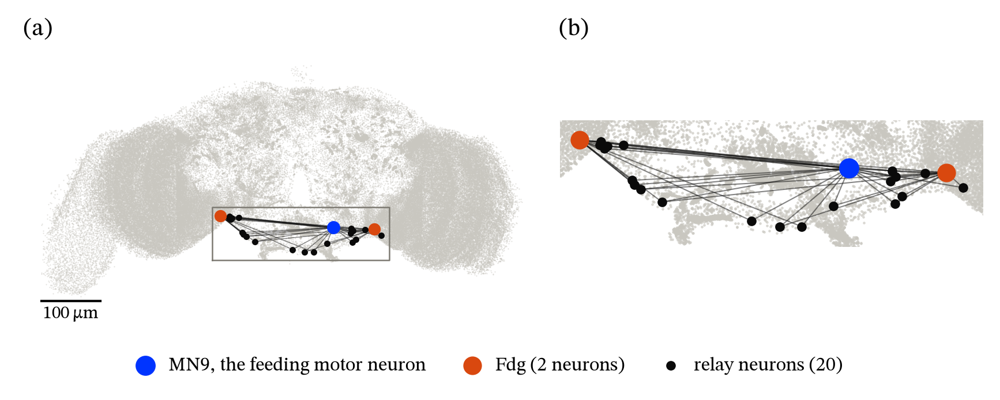
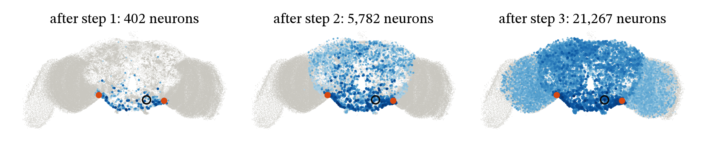
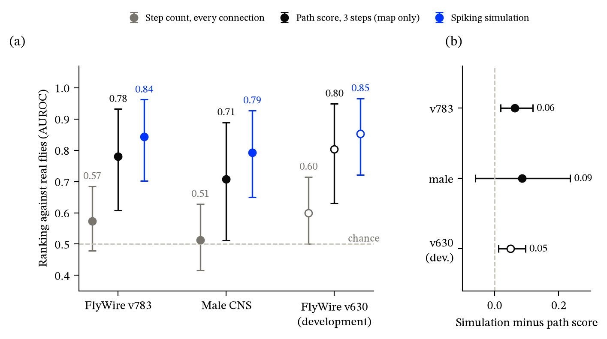
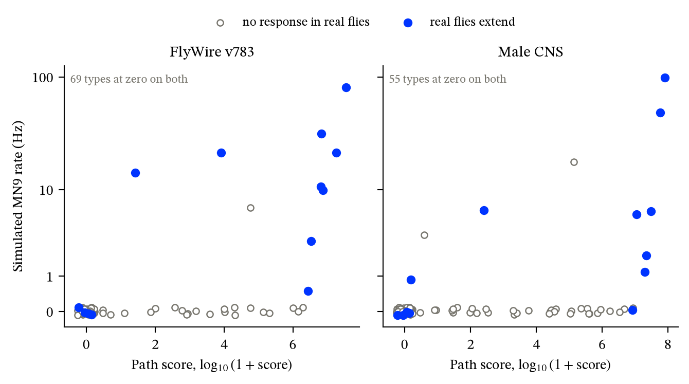
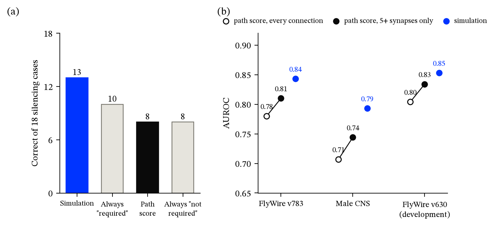
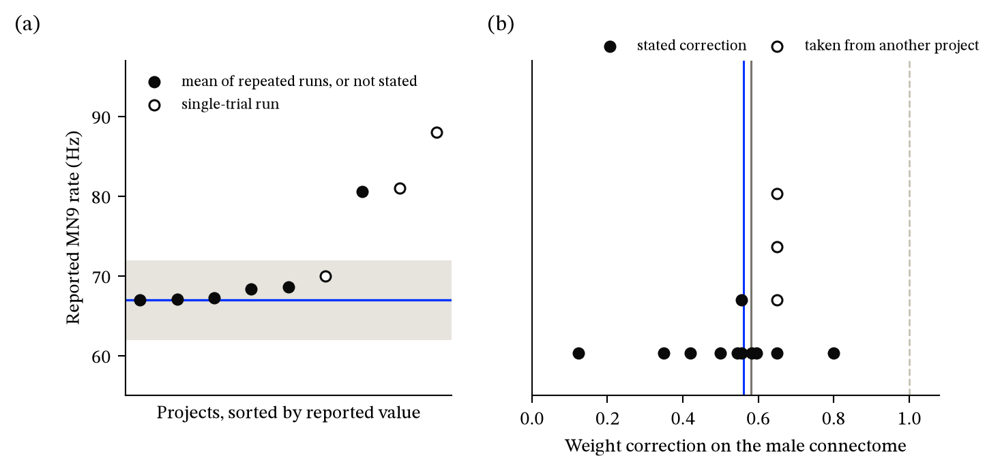
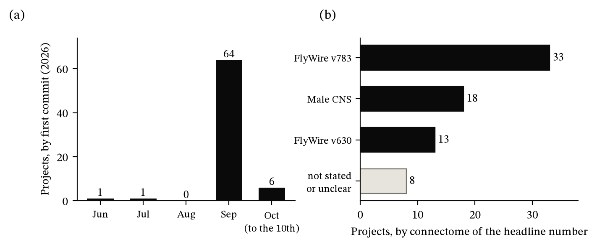
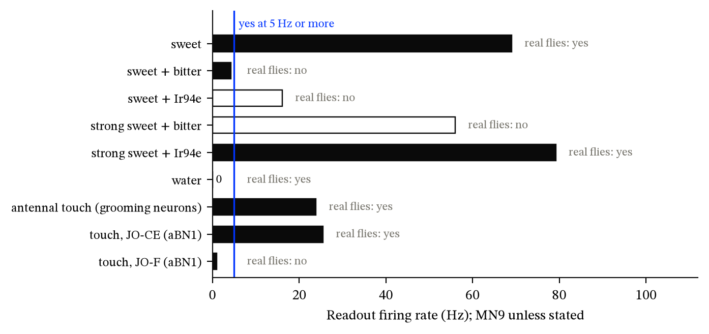

# What the Fly's Wiring Map Predicts Without a Simulation

Terramind  
https://terramind.org

Agrim  
agrim@terramind.com

Version 1.3 (release candidate), 10 October 2026. Our own analysis; not peer-reviewed.  
Project page and interactive lab: https://terramind.org/fly-brain/

---

## Abstract

Shiu et al. (2024) built a spiking simulation of the fruit fly brain from its wiring map and showed that it predicts which neurons make a real fly extend its proboscis [1]. For that one behaviour, the feeding response, we ask how much of the prediction is already in the wiring map, before any simulation is run. Using a plan fixed before the map-only scores were computed, we compare a map-only "path score" (signed connection weights followed for three steps to the feeding motor neuron MN9) with the simulation, against the paper's real-fly screen of 106 cell types. The path score ranks cell types above chance on a later version of the same female connectome (AUROC 0.78, 95% interval 0.61–0.93) and on a second, male connectome (0.71, 0.51–0.89). The simulation ranks better than the path score on the female connectome (0.84; difference 0.06, 0.02–0.12); on the male connectome the difference is not resolved. On 18 cases in which a cell type is silenced, the simulation is correct in 13 and the path score in 8, which equals one constant guess and is below the other. Separately, we surveyed 97 public code repositories that state a firing rate for MN9. Seventy-two report their own measurement under sugar stimulation. Of those that ran the paper's headline case, 6 of 8 report a rate within 5 Hz of the reference value, short of the 80% we had set for agreement. Six of seven that report a shuffled-wiring control found the response silent or cut by at least 90%. Fourteen state a correction to the synaptic weight for the male connectome, from 0.12 to 0.8 of the published value. Limits: one real-fly screen with 13 or 14 positive cell types, one new individual, and an analysis carried out largely by AI agents under human direction.

## 1. Introduction

The adult fruit fly brain has been mapped at the level of individual synapses [2, 3]. Shiu et al. turned that map into a leaky integrate-and-fire simulation with a single free parameter and tested it against experiments [1]. In the best-known test, activating sugar-sensing taste neurons in the simulation drives the motor neuron MN9, which extends the proboscis; in a screen of 106 cell types in the fly's feeding region, the simulation's predictions agreed with real flies in most cases. The authors also report that, excluding that screen, in which most cell types did not elicit MN9 activation, the model's accuracy is 84% [1].

A second connectome, of the male central nervous system, was described in a 2025 preprint and published in 2026 [4, 5]. In September 2026 many people posted code that re-runs the Shiu model. That makes two questions timely.

**How much is in the map, and how much does the simulation add?** Supplementary Table 3 of [1] lists a "Shortest Path" value next to the simulation's output for each cell type, but the paper does not score a map-only predictor against the real-fly results. We do, to quantify both parts: what the wiring alone tells you, and what simulating it adds.

**What do public re-runs report?** We read what a defined set of public projects report for the paper's headline quantities and compare them with the reference values.

We fixed our tests and decision rules before the map-only scoring and the survey extraction (the simulation outputs already existed), and we report every verdict, including one that went against our expectation and several that came out inconclusive. Section 2.5 states what we already knew when each rule was written. A Supplementary Note reports one further check, in which the simulation is packaged as a yes/no "instinct function" on the fly's own senses.

## 2. Methods

### 2.1 Data and model

- **Connectomes.** FlyWire v630 (the version used in [1]; 127,400 neurons in the model) and FlyWire v783 (138,639 neurons) [2, 3]; the male CNS v1.0 [4] (165,122 neurons and 25,563,096 connections in our conversion). For the male connectome each neuron's sign comes from its top predicted transmitter; 14,365 neurons with an unclear transmitter and 502 with none were treated as excitatory.
- **Model.** The model of [1], built with the authors' code [6] (commit `91bdd1e`, MIT licence) and the published parameters, run on Brian 2 version 2.7.1 [7] through our own runner (it builds the network once and restores it between trials).
- **The male model is our adaptation, not the model as published.** At the published weight, activity on the male connectome runs away. We multiply the synaptic weight by 0.561, the inverse of the ratio of synapse counts between matched cell types in the two datasets that we measured (1.78). The male-connectome preprint reports "a scaling factor of 0.581 which we apply to all male CNS edge weights for cross-dataset comparisons" [5] (we have not checked whether the published version [4] gives the same figure). Others ran the model on the male connectome before us: flymsg found a working weight [8], Fly.exe scored a male-connectome model on a sub-network [9], and Fugsukjit reports a calibration [10]. In an earlier experiment of ours this male model was about as accurate as the female one on the screen but did not keep that verdict under weaker stimulation or weaker weights, so it should be read as a serviceable comparator, not a validated model.
- **Real-fly results.** Supplementary Table 3 of [1]: for 106 cell types, the fraction of flies (of 10) that extended the proboscis when that type was activated with light. A type is positive if the fraction is above zero (14 of 106). For silencing, Supplementary Tables 2 and 5 of [1].
- **Simulation outputs.** For each cell type, the mean firing rate of MN9 over 30 one-second trials with that type activated at 50 Hz. On FlyWire v630 with the authors' own neuron lists, our runs make the same fires/does-not-fire call as the paper's table for all 106 types (rate correlation r = 0.9986) and reproduce its score against real flies (10 hits, 1 false alarm, 4 misses).

### 2.2 Predictors

| | Predictor | Definition |
|---|---|---|
| P1 | Step count | Fewest synaptic steps from any neuron of the cell type to MN9, counting every listed connection. |
| P2 | Path score | Place 1 on every neuron of the type; multiply by the signed connection matrix and clip negatives to zero, three times; sum what arrives at MN9 over the three steps. |
| P3 | Simulation | Mean MN9 firing rate in the spiking simulation. |

**Table 1.** The three predictors.

P2 is itself a very simple model: a rectified linear calculation on the map, with no spiking dynamics, no time constants and no free parameter beyond the number of steps. Figure 1 shows the routes the path score follows for one cell type, and Figure 2 how far the signal has spread after each step.

**Figure 1. The routes the path score follows, for one cell type.** (a) The FlyWire v783 model network seen from the front, one dot per neuron (138,625 of 138,639 neurons have a position; a dot is an annotated point on the neuron, not its cell body; positions from the FlyWire annotations [3]). Orange: the two neurons of Fdg, a cell type whose activation made 8 of 10 real flies extend the proboscis in the screen of [1]. Blue: the feeding motor neuron MN9. Black: the 20 neurons that receive net excitation from Fdg and have an excitatory connection onto MN9, with those connections drawn. (b) The boxed region enlarged.

**Figure 2. The map-only signal after one, two and three steps.** Same view and cell type as Figure 1. Blue dots are the neurons with a positive value after each step (402, 5,782 and 21,267 neurons); darker is larger, on a log scale. Orange: Fdg. Circle: MN9. Nothing arrives at MN9 after step one, 4,708 after step two and 17,916,312 after step three; their sum, 17,921,020, is the path score of Fdg.

### 2.3 Test sets

- **FlyWire v783:** 101 cell types (13 positive), each mapped to all neurons of its annotated type.
- **Male CNS:** 99 cell types (13 positive), mapped by matching type names; the left-side MN9 is the readout because the right-side neuron is flagged as hard to trace.
- **Silencing:** 18 cases (9 cell types under sugar, 9 under water; 11 distinct types) in which real flies were tested with that type silenced, computed on FlyWire v630. The simulation's prediction is the paper's published ratio of MN9 firing with and without the type ("required" if below 0.8, the paper's rule). The map-only prediction applies the same rule to P2 computed with and without the type's outgoing connections. The plan listed 20 cases; one type (Zorro, two cases) is absent from the authors' cell-type file and was excluded under the plan's rule.

The real-fly labels are the same in every set, so these are tests on other connectomes, not new fly experiments. FlyWire v783 is a later version of the same female brain as v630, on which the path score's form was chosen: 52 of its 101 types use identical neuron lists, and path scores on the two have a rank correlation of 0.92. Only the male CNS is a new individual.

### 2.4 Statistics and decision rules

Ranking quality is the area under the ROC curve (AUROC; 0.5 is chance), ties counted as half. Intervals are 95% percentile bootstrap intervals over cell types (10,000 resamples, seed 0); differences use a paired bootstrap.

- **M1** (the map alone carries signal): supported if the lower end of P2's interval is above 0.5 on both test connectomes.
- **M2** (the path score cannot be told apart from the simulation on this screen): supported if the interval of P3 − P2 includes zero and the difference is at most 0.10 on both; not supported if the interval lies wholly above zero on either.
- **M3** (the simulation does better on silencing): supported if the simulation is correct on at least three more cases than P2.

### 2.5 What was fixed in advance, and what was already known

The predictors, test sets, statistics and rules were written to a plan file and committed to a local version-control repository at 10:34 on 10 October 2026 (`PLAN3.md`, commit `abb98a0`), before the map-only scores and the survey extraction; the first results were committed seven minutes later. This is a pre-specified plan, not a registration with a third party; the repository history is to be released with the paper. The predictors were fixed in the plan's text; the code implementing them was committed with the results.

| Verdict | Already known when the rule was written |
|---|---|
| M1 | A pilot on v630 had tried eight variants of the path score; "signed, three steps" was chosen from it (AUROC 0.80 there). The paper's own Shortest Path column had been scored on v630 (0.77). Nothing had been scored on v783 or the male CNS. |
| M2 | The simulation outputs on both test connectomes existed and had been scored against the same screen in an earlier experiment. The paired difference on v630 had not been computed; from the pilot's point estimates (0.80 against 0.85) we expected the test to be unable to separate them. |
| M3 | The paper's published silencing ratios. The path score had not been run on silencing. |
| R1, R3 (survey) | A draft extraction from the search step had shown its rough pattern: v630 values near 67 Hz, and male-connectome corrections spread from about 0.15 to 0.65, which already exceeded R3's two-fold bar. |
| R2 | The draft extraction already listed shuffled-wiring outcomes for several projects, most of them silent. |

**Table 2.** What was already known when each rule was written.

### 2.6 Survey of public re-runs

**Design.** A retrospective survey of public repositories, in the spirit of repository-mining studies of research code [11, 12] and distinct from prospective many-analysts studies [13, 14]. No third-party code was executed.

**Frame.** The 97 GitHub repositories whose README contained a line with both "MN9" and a value in Hz in a search snapshot of 10 October 2026. The same automated search counted about 720 repositories whose README cites the model; we have not verified that count. Coverage of public GitHub is unknown, so all counts are lower bounds.

**Inclusion.** A repository is included if its README reports an MN9 firing rate that the project itself measured, from a Shiu-type model on a fly connectome, under sugar taste-neuron activation.

**Extraction.** Two passes worked from the same README copies with a fixed codebook, without sight of each other's output. Disagreements were resolved from the quoted lines and logged.

**Rules.**

- **R1:** among included projects coded as FlyWire v630 at 100 Hz, supported if at least 80% report MN9 within 5 Hz of 67.0 Hz; not supported if fewer than 50% do.
- **R2:** among projects reporting a shuffled or rewired control, supported if at least 80% report MN9 silent or reduced by at least 90%; not supported if fewer than 50% do.
- **R3** (no agreed correction for the male connectome): among projects stating a weight correction, supported if the largest is at least twice the smallest; not supported if within 1.25 times.

Results between the two bars are inconclusive. The reference value of 67.0 Hz is the mean MN9 rate in the example run shipped with the authors' code [6]; Supplementary Table 1A of [1] lists 65.7 Hz for the same condition. For scale, the trial-to-trial standard deviation in our own first 30-trial run of this condition (mean 67.5 Hz) is 4.8 Hz. The plan's R1 had a second clause ("or state they reproduce the paper's shipped sugar result") that we did not define tightly enough; we report the first clause and note the others.

## 3. Results: the map and the simulation

### 3.1 The wiring map alone carries signal

**Figure 3. Ranking of cell types against the real-fly screen.** (a) AUROC for three predictors: step count over every listed connection, the three-step path score, and the spiking simulation (Table 1). A cell type is positive if any of 10 flies extended the proboscis on activation. Sets: FlyWire v783 (101 types, 13 positive), male CNS (99 types, 13 positive; simulation at weight ×0.561), FlyWire v630 (106 types, 14 positive). Bars are 95% bootstrap intervals. (b) The paired difference, simulation minus path score. Open markers: development data, on which the path score's form was chosen.

On both test connectomes the path score ranks the cell types that work in real flies above those that do not (Figure 3a): AUROC 0.780 (0.608–0.932) on FlyWire v783 and 0.707 (0.511–0.889) on the male CNS. **M1 is supported.** On the male CNS, the only new individual, the lower bound is close to chance (0.506–0.513 across twelve bootstrap seeds). A rank test gives one-sided p = 0.004 there and p < 0.001 on v783, and a stratified bootstrap gives 0.521–0.883 and 0.615–0.928 (both exploratory).

Many path scores are exactly zero (69 of 101 types on v783; 56 of 99 on the male CNS), so much of the ranking is a split between types with any signed route to MN9 within three steps and types with none. The sensitivity variants named in the plan give 0.706 (two steps), 0.780 (four steps) and 0.754 (excitatory connections only) on v783, and 0.731, 0.730 and 0.754 on the male CNS.

### 3.2 The simulation ranks better than the path score on the female connectome

| Set | Path score (P2) | Simulation (P3) | P3 − P2 |
|---|---|---|---|
| FlyWire v783 | 0.780 (0.608–0.932) | 0.843 (0.702–0.962) | 0.063 (0.019–0.119) |
| Male CNS, weight ×0.561 | 0.707 (0.511–0.889) | 0.793 (0.650–0.927) | 0.086 (−0.060–0.236) |
| FlyWire v630 (development) | 0.804 (0.631–0.949) | 0.853 (0.721–0.966) | 0.050 (0.012–0.096) |

**Table 3.** AUROC against the real-fly screen, with 95% bootstrap intervals, and the paired difference.

On FlyWire v783 the simulation is ahead and the interval of the difference excludes zero (Figure 3b); the lower bound is stable across twelve seeds (0.019–0.021). **M2 is not supported:** this test can distinguish the two, in the simulation's favour. We had expected the opposite. On the male CNS the difference is of similar size but its interval includes zero, so on the only new individual the comparison is unresolved. With the other weights we ran on the male CNS, the simulation is ahead by 0.116 (0.022–0.245) at ×0.698 and by 0.063 (−0.026–0.199) at ×1.0.

Three qualifications. The comparison is with one fixed path score, not with every possible map-only predictor (Section 3.4). FlyWire v783 is the same brain as the development data. And the 50 Hz activation rate is the original authors' choice for this screen; we did not vary it here.

*Exploratory.* On v783, the four real positives to which the path score assigns zero are also silent in the simulation. The two differ on the negatives: one negative type fires in the simulation, while 23 have a non-zero path score. This is consistent with the simulation's advantage on this screen being selectivity (Figure 4). Counting a type as positive only if at least 20% of flies responded (12 positives) gives 0.815 against 0.872 on v783 and 0.742 against 0.819 on the male CNS.

**Figure 4. Every cell type on both predictors.** Each point is one cell type: its path score (horizontal, log scale) against its simulated MN9 rate (vertical, log scale). Blue points are types whose activation makes real flies extend the proboscis. Points at zero are spread slightly so they can be seen. Many types that do nothing in real flies have a non-zero path score but stay silent in the simulation.

### 3.3 Silencing: the simulation carries information, the path score none we can detect

The simulation is correct on 13 of 18 silencing cases and the path score on 8. **M3 is supported** by the rule. The two disagree on five cases and the simulation is right on all five (exact sign test, two-sided p = 0.06).

Two constant guesses give the scale. Ten of the 18 cases are "required" in real flies, so always answering "required" scores 10 and always answering "not required" scores 8. The path score equals the weaker constant; it labels only four cases "required" (Figure 5a). Ranked without a threshold, the simulation's ratios give AUROC 0.74 and the path score's 0.58 (exploratory). With four steps the path score reaches 10 of 18. The verdict held under the alternative labellings we tried, including adding Zorro's two cases from identifiers found elsewhere in the supplement (15 of 20 against 9 of 20).

### 3.4 Step counts and weak connections (exploratory)

Step count over every listed connection is uninformative (0.573 on v783 and 0.513 on the male CNS; both intervals include 0.5), because almost every cell type is within two steps of MN9. Our step counts match the "Shortest Path" column of [1] for 56 of 106 types. Counting only connections of five or more synapses reproduces the column for 104 of 106. The supplement's legend defines the column as "the minimum number of synapses separating neurons in the split-GAL4 and MN9" and states no threshold, so the five-synapse reading is our inference; we have not yet confirmed it with the authors.

Leaving out weak connections improves both map-only predictors. With the five-synapse threshold, step count gives 0.761 on v630 (the paper's column: 0.771), 0.734 on v783 and 0.700 on the male CNS; the path score gives 0.834, 0.810 and 0.744 (Figure 5b). Against this thresholded path score the simulation's lead shrinks to 0.033 on v783 (stratified interval 0.007–0.068) and 0.049 on the male CNS (−0.077–0.175). The threshold was chosen after seeing the data, so these figures are not tests. They suggest that the gap between the map and the simulation depends on how the map is read, and that a better map-only predictor than ours is likely to exist.

**Figure 5. Silencing, and the effect of leaving out weak connections.** (a) Correct calls on the 18 silencing cases for the simulation and the path score, beside two constant guesses. (b) AUROC of the path score over every connection, the path score over connections of five or more synapses (exploratory), and the simulation, on each connectome.

## 4. Results: what public re-runs report

**Figure 6. What public projects report in their READMEs.** (a) MN9 firing rate for the headline case (FlyWire v630, sugar neurons at 100 Hz) in nine projects: the eight scored under R1 plus one more that names the v630 data file without stating the version. Blue line: the authors' shipped example run (67.0 Hz); band: ±5 Hz. Open circles: single-trial runs by the projects' own description. (b) Weight corrections stated for the male connectome, as a fraction of the published weight, in 14 projects; points are stacked where values coincide; open circles are values taken from another project [15]. Lines: 0.561 (ours), 0.581 (the male-connectome preprint), 1.0 (the published weight).

Of the 97 repositories, 72 were included and 25 excluded. The two extraction passes agreed on inclusion for 90 of 97; the seven disagreements were all resolved towards exclusion. The reported MN9 value agreed between passes for all 72 on the first listed value. Sixty-four of the 72 made their first commit in September 2026. The headline number is on FlyWire v783 in 33 projects, the male CNS in 18 and FlyWire v630 in 13. The projects are not independent of one another: many share code or sources and appeared within weeks of each other (Figure 7).

**Figure 7. The 72 included projects.** (a) Month of first commit, from one automated pull of the GitHub API. (b) Connectome on which each project's headline MN9 number was obtained.

**R1, the headline case: inconclusive.** Eight projects were coded as FlyWire v630 at 100 Hz, and 6 report MN9 within 5 Hz of 67.0 Hz (75%; the bar was 80%). The six are 67.0, 67.1, 67.3, 68.4, 68.6 and 70; the others are 80.6 and 88, and a ninth project that names the v630 file reports 81.0 (Figure 6a). All three outliers are high, and two of them, with the 70, are single-trial runs. One of the eight (80.6) names the v630 data file without stating the version, as the ninth does; counting neither gives 6 of 7. The same six fall within 5 Hz of the paper's own 65.7 Hz. Other readings: 6 of 9 with the ninth project, 8 of 11 with projects that compare their number with 67.0 Hz, and 5 of 6 without the single-trial runs. Our own run gives 67.5 Hz.

**R2, shuffled wiring: supported, on few projects.** Seven projects report what happens to MN9 when the wiring is shuffled or rewired. Five report it silent; one reports it abolished under rewiring and cut from 41 Hz to a median of 3 Hz under a weight shuffle, which meets the rule's 90% reduction; and one reports a graded loss under partial rewiring. The seven span different connectomes and settings, and one further ambiguous report would have made the result inconclusive.

**R3, the male connectome: supported; there is no agreed correction.** Fourteen projects state a weight correction, from 0.124 to 0.8 of the published value (Figure 6b). Five values lie between 0.54 and 0.60, near our 0.561 and the preprint's 0.581 [5]: two of 0.556 from synapse-count arithmetic, two (0.582 and 0.596) tuned to the original paper's response criterion, and one (0.545) calibrated on a basis its README does not state. Ten of the fourteen lie between 0.5 and 0.65, but they are not ten separate results: four values of 0.65 trace to a single project [15], and one of 0.5 comes from a model with an added mechanism. Without the lowest and highest values the largest is 1.86 times the smallest, which would not meet the bar. Two projects state that no single factor works.

Outside the headline case, settings differ too much to compare: on FlyWire v783 at 100 Hz, nine projects report MN9 rates from 15.7 to 190 Hz, with different or unstated taste-neuron sets. The plan also called for our own re-run of any complete setting reported by three or more projects for which we lacked a reference; only the headline case qualified, so none was needed.

## 5. Course of the work and corrections

This work began as a different question: does the Shiu model, unchanged, transfer to the male connectome? We reproduced the original (MN9 at 67.5 Hz against 67.0 Hz in the authors' shipped run; silent in 100 of 100 shuffles). On the male connectome activity ran away, which we traced to its higher synapse counts. We then found that others had already covered most of this ground: the male-connectome preprint reports the synapse-count difference [5]; flymsg had run the model on the male connectome and found a working weight [8]; Fly.exe had scored a male-connectome model against the same real-fly screen on a sub-network [9]; Fugsukjit had benchmarked a re-implementation against the paper's tables [10]; and Cho's flybench provides pre-specified benchmark tasks for such models [16]. Our density-matched male model gave 8 hits and 3 false alarms on 99 types, consistent with those results, but did not keep its verdict under weaker stimulation or weaker weights. We did not pursue it as a finding and changed the question to the one in this paper.

| Stage | What was corrected |
|---|---|
| First experiment | A readout neuron flagged as hard to trace; wording that overstated the result |
| Transfer experiment | A claim of novelty withdrawn after a prior-work search |
| This paper, results | Male-connectome corrections described as independently arrived at; both test sets described as new; a miscount (10 cell types for 11); a dropped row in the step-count check |
| This paper, drafts | "Independent" for the surveyed projects; the reference value 67.0 Hz attributed to the paper instead of the shipped run; a conclusion ("adds measurable value") broader than its evidence; a silencing baseline that was missing |

**Table 4.** Corrections made after automated audits and fact-checks (Section 8).

## 6. Related work

- **Map-only predictors.** Linear and graph-based summaries of connectome influence exist [17, 18, 19], and Shiu et al. discuss graph-traversal and signal-cascade models, which they consider "unlikely to be useful for predicting what neurons contribute most to a given circuit" [1]; our step-count result (Section 3.4) bears on that remark only loosely, since it is a plain shortest-path count scored on a different question. The flywire-fly-lab project compares wiring metrics with the simulation's own knockout effects [20]. Fly.exe includes a control in which connections are averaged within cell types, still run as a spiking simulation [9]. The flyconn project enumerates signed one-to-three-step routes beside simulated silencing effects [21]. In searches up to 10 October 2026 (GitHub repositories and READMEs, bioRxiv titles and abstracts from 1 September, arXiv, OpenAlex and Europe PMC; Zenodo's search failed, and Google Scholar, SSRN and OSF were not searched) we found no scoring of a map-only predictor against the real-fly screen alongside the simulation. We have not read flyconn's code, nor two further items in our notes that may overlap; the search will be repeated at public release.
- **Perturbation studies of the model.** Removal of neurons or connections has been examined by several groups, for example An [22].
- **Reproducibility studies.** Many-analysts studies [13, 14] and repository-scale audits of research code [11, 12] are the methodological neighbours of Section 2.6. Curated lists of fly-brain projects exist but do not extract or compare reported numbers; we found no survey of re-runs of this model.

## 7. Limitations

- **One real-fly screen.** The ranking results rest on 13 or 14 positive cell types; intervals are wide.
- **Some positives were known beforehand.** Ten of the 14 positive types carry a note in Supplementary Table 3 pointing to earlier reports that activating them elicits proboscis extension [23, 24, 25]; for the other four we found none. We relied on the table's notes and on an automated reading of the earlier papers' source data.
- **Base rate.** About 87% of types are negative, so accuracy is uninformative; we report ranking quality.
- **One new individual.** On the male CNS, M1 holds narrowly and the simulation's lead is unresolved; the male simulation is our adaptation.
- **The path score is a model too,** its form was chosen on FlyWire v630, and a thresholded version does better (Section 3.4).
- **Prior scoring.** The simulation outputs had been scored against the screen before the plan was written (Table 2).
- **Silencing.** Eighteen cases over 11 types on the development connectome, five discordant, with the simulation's ratios taken from the paper.
- **Survey.** README text only; self-reported numbers; no third-party code executed; projects not independent; coverage unknown; R1 rests on eight projects and R2 on seven; the rules were written after a rough view of the data; first-commit dates come from one automated pull.
- **Fly, sex and data pipeline are confounded** in any comparison between the two connectomes.
- **How the work was done** (Section 8).

## 8. How this work was produced

This work was carried out over two days (9–10 October 2026) by one person (Agrim) directing AI language-model agents inside a desktop research tool (Nucleus, by Terramind).

| Step | Done by |
|---|---|
| Choice of questions and standards; decisions to stop, change direction and continue | Agrim |
| Analysis plans, code, simulations, statistics, figures, drafting | AI agent, under Agrim's direction |
| Literature and repository searches; survey extraction (two passes) | Separate AI agent runs |
| Re-computation of the pre-specified results from the raw files with separate code | Separate AI agent run |
| Fact-checks of each draft against the records; a referee-style review | Separate AI agent runs |
| Reading of primary sources | AI agents |

**Table 5.** Who did what.

The re-computations and fact-checks were separate runs without access to the main session's reasoning, but they are runs of the same kind of system and can share its blind spots. None is an independent human review. The exploratory figures added after the review (Sections 3.1 to 3.4, marked exploratory) were checked by a fact-check pass; of those, the thresholded scores were confirmed against the result file and not recomputed independently. Agrim chose the questions, set the standards, made each decision and reviewed the agents' reports; he did not independently re-derive the results or re-read the primary sources. The authors take responsibility for the content.

**Competing interests.** Terramind makes the tool used and runs a science-explainer channel that will feature this work. **Funding.** None external. **Tools.** Researched with Terramind Science, in Nucleus.

## 9. Data and code availability

All plans, code, result files, the frozen survey frame with README copies, both extraction passes and the resolved table are in the project repository with its full history, which is to be made public with an archive DOI at release; this release candidate precedes that. Third-party data are used under their own licences: the authors' model code (MIT) [6]; the male CNS (CC BY 4.0) [4]; FlyWire data carry CC BY-NC 4.0 terms on flywire.ai (its Zenodo deposits state CC BY 4.0); this is a non-commercial project, and FlyWire-derived tables are shared for non-commercial use with attribution.

## Acknowledgements

Correspondence: Agrim, agrim@terramind.com.

We thank the authors of [1] for releasing code and data that make this kind of check possible, and the people behind the public projects whose READMEs we read. As of this version the original authors and the named projects have not yet been contacted; they will be before public release, and their corrections will be incorporated.

---

## Supplementary Note. The simulation as an instinct function

**Question.** Can the simulation be used as a function that takes a situation described in the fly's own senses and returns the fly's innate response as a yes/no answer? We stay inside the senses and behaviours tested in [1] and make no claim beyond them.

**Method.** Senses are neuron lists named in the supplement of [1]: sweet (21 neurons), bitter (21), water (18), Ir94e (18), and antennal touch (146 mechanosensory neurons; two subsets, JO-CE with 70 and JO-F with 60). Every active sense is driven at 100 Hz, and "strong sweet" at 200 Hz, so that no rate is tuned to an outcome. Outputs: *extend* (MN9), and *groom* (the highest mean rate among aBN1, aDN1 and aDN2; for the subset cases aBN1 alone, which is what the paper measured). The answer is yes if the readout's mean rate over 30 trials is at least 5 Hz. FlyWire v630. Plan committed about 18 minutes before the result (`PLAN4.md`, commit `d91f86c`). Rule I1: supported if at least 7 of 9 cases match real flies, not supported if 4 or fewer. Rule I2: with connection strengths permuted (10 permutations), supported if fewer than 10% of the 50 (case, permutation) pairs answer yes.

**What was known.** Four of the nine cases were effectively known in advance: sweet alone, antennal touch (the paper's supplement gives the simulated rate), and the paper's stated predictions for the two subsets. Five were open only in the sense that we had not run them at uniform rates; the paper states its model's predictions for the mixtures at tuned rates. Mapping 1 M sucrose to 200 Hz, and light-activated bitter or Ir94e neurons to 100 Hz, is our assumption.

**Figure S1.** Readout rate for the nine situations. Filled bars: the yes/no answer matches real flies. Line: the 5 Hz rule. The water bar has zero length and is a miss. Real-fly outcomes are from Supplementary Tables 9A and 9B and Fig. 5h of [1]; the outcome for touching the whole antenna is inferred from the paper's statement that each subset alone triggers grooming.

| Situation | Rate (Hz) | Answer | Real flies | Match |
|---|---|---|---|---|
| sweet | 69.0 | yes | yes (26 of 30) | yes |
| sweet + bitter | 4.3 | no | no (3 of 30) | yes |
| sweet + Ir94e | 16.1 | yes | no (3 of 26) | no |
| strong sweet + bitter | 56.0 | yes | no (5 of 30) | no |
| strong sweet + Ir94e | 79.2 | yes | yes (20 of 26) | yes |
| water | 0.0 | no | yes | no |
| antennal touch | 23.9 | yes | yes (inferred) | yes |
| touch, JO-CE: is aBN1 active? | 25.5 | yes | yes | yes |
| touch, JO-F: is aBN1 active? | 0.9 | no | no | yes |

**Result.** Six of nine cases match, one short of the bar (**I1 inconclusive**); of the five open cases, two match. For comparison, always answering yes would score five of the nine. We read this as no evidence that a single uniform stimulus level recovers the mixture outcomes. In two misses the response moves the right way but not far enough (Ir94e cuts the sweet response from 69 to 16 Hz; bitter cuts the strong sweet response from 92 to 56 Hz), and water at this level does not reach MN9. At the rates the original authors tuned, we approximately reproduce their simulated values (ours against theirs: sugar 39.3 against 40.8 Hz; with bitter 0.03 against 1.3; with Ir94e 0.27 against 1.1; water 36.8 against 40.4). Sweet alone gives 69.0 Hz here and 67.5 Hz in our first experiment; both are 30-trial means from different runners and random seeds. Two of our own choices matter: the sweet-plus-bitter case passes narrowly (4.3 Hz; interval over trials 3.4–5.2), and with the same rate for both sucrose concentrations the count would be 7 of 9.

**Permuted wiring.** The sweet cases answer yes in 0 of 20 pairs; the grooming cases in 9 of 20. Antennal neurons contact aBN1 directly (36 connections, 148 synapses in the connectivity table), so a one-step route survives a permutation of strengths. Pooled with 10 uninformative water pairs this is 9 of 50 (**I2 inconclusive**). The two outputs do not cross: touch gives 0 Hz at MN9 and sweet gives 0 Hz at the grooming neurons.

**Limits and credit.** No hunger or thirst state; yes/no answers only; one connectome; nine cases, all from [1]. Related public projects: ask-the-fly maps four taste levels to a feeding label [26]; fly-instinct packages a circuit as an "Instinct Engine" [27]; flybench includes a bitter-suppression task with shuffled-wiring controls [16]; Fugsukjit specified sugar-plus-bitter, sugar-plus-Ir94e, water and antennal tests in advance, and his water test also failed at default drive [10]; femaleflybrain and brainfly report the same directions [28, 29]. Body models that could carry such responses into action exist [30, 31]. We use the 146 antennal neurons listed in the supplement of [1].

---

## References

1. Shiu PK, Sterne GR, Spiller N et al. (2024). A Drosophila computational brain model reveals sensorimotor processing. *Nature* 634, 210–219. https://doi.org/10.1038/s41586-024-07763-9
2. Dorkenwald S, Matsliah A, Sterling AR et al. (2024). Neuronal wiring diagram of an adult brain. *Nature* 634, 124–138. https://doi.org/10.1038/s41586-024-07558-y
3. Schlegel P, Yin Y, Bates AS et al. (2024). Whole-brain annotation and multi-connectome cell typing of Drosophila. *Nature* 634, 139–152. https://doi.org/10.1038/s41586-024-07686-5
4. Berg S, Beckett IR, Costa M et al. (2026). Sexual dimorphism in the complete Drosophila male central nervous system connectome. *Cell* 189, 5504–5526.e15. https://doi.org/10.1016/j.cell.2026.08.015
5. Berg S, Beckett IR, Costa M et al. (2025). Sexual dimorphism in the complete connectome of the Drosophila male central nervous system. bioRxiv (preprint). https://doi.org/10.1101/2025.10.09.680999
6. Shiu P, Spiller N. Drosophila_brain_model (code), commit `91bdd1e`. https://github.com/philshiu/Drosophila_brain_model
7. Stimberg M, Brette R, Goodman DFM (2019). Brian 2, an intuitive and efficient neural simulator. *eLife* 8, e47314. https://doi.org/10.7554/eLife.47314
8. Mazza G. flymsg (code), commit `cb3ed70`. https://github.com/gianlucamazza/flymsg
9. Ibtisam-Mohammad. Fly.exe (code), commit `cc25411`. https://github.com/Ibtisam-Mohammad/Fly.exe
10. Fugsukjit V (2026). Benchmarking a whole-brain connectome model of Drosophila against experimental data: diagnosing knockout-prediction failures and a candidate excitatory role for the water-taste neuron Usnea. Zenodo, v1. https://doi.org/10.5281/zenodo.23025559 (concept DOI; code at https://github.com/vichienFF/flybrain-connectome-benchmark, commit `c4ef087`)
11. Trisovic A, Lau MK, Pasquier T et al. (2022). A large-scale study on research code quality and execution. *Scientific Data* 9, 60. https://doi.org/10.1038/s41597-022-01143-6
12. Pimentel JF, Murta L, Braganholo V et al. (2019). A Large-Scale Study About Quality and Reproducibility of Jupyter Notebooks. *2019 IEEE/ACM 16th International Conference on Mining Software Repositories (MSR)*, 507–517. https://doi.org/10.1109/MSR.2019.00077
13. Silberzahn R, Uhlmann EL, Martin DP et al. (2018). Many Analysts, One Data Set: Making Transparent How Variations in Analytic Choices Affect Results. *Advances in Methods and Practices in Psychological Science* 1, 337–356. https://doi.org/10.1177/2515245917747646
14. Botvinik-Nezer R, Holzmeister F, Camerer CF et al. (2020). Variability in the analysis of a single neuroimaging dataset by many teams. *Nature* 582, 84–88. https://doi.org/10.1038/s41586-020-2314-9
15. blendi-remade. fly-brain-minecraft (code), commit `6cfa301`. https://github.com/blendi-remade/fly-brain-minecraft
16. Cho B (2026). flybench: a behavioural benchmark for whole-connectome simulations of Drosophila. Zenodo, v0.2.1. https://doi.org/10.5281/zenodo.22886374 (concept DOI; code at https://github.com/brandoncho369/flybench, commit `3052ce5`)
17. Bates AS, Phelps JS, Kim M et al. (2026). Distributed control circuits across a brain-and-cord connectome. *Nature* 656, 957–970. https://doi.org/10.1038/s41586-026-10735-w
18. Pospisil DA, Aragon MJ, Dorkenwald S et al. (2024). The fly connectome reveals a path to the effectome. *Nature* 634, 201–209. https://doi.org/10.1038/s41586-024-07982-0
19. Lin A, Yang R, Dorkenwald S et al. (2024). Network statistics of the whole-brain connectome of Drosophila. *Nature* 634, 153–165. https://doi.org/10.1038/s41586-024-07968-y
20. suifei. flywire-fly-lab (code), commit `776442e`. https://github.com/suifei/flywire-fly-lab
21. moiz-lakkadkutta. flyconn (code), commit `53d1715`. https://github.com/moiz-lakkadkutta/flyconn
22. An D (2026). How sparse can a fly-brain model be? Connection strength, wiring placement, network state and task jointly determine function-preserving compression of the Drosophila connectome. bioRxiv (preprint). https://doi.org/10.64898/2026.09.19.752860
23. Shiu PK, Sterne GR, Engert S et al. (2022). Taste quality and hunger interactions in a feeding sensorimotor circuit. *eLife* 11, e79887. https://doi.org/10.7554/eLife.79887
24. Flood TF, Iguchi S, Gorczyca M et al. (2013). A single pair of interneurons commands the Drosophila feeding motor program. *Nature* 499, 83–87. https://doi.org/10.1038/nature12208
25. Marella S, Mann K, Scott K (2012). Dopaminergic Modulation of Sucrose Acceptance Behavior in Drosophila. *Neuron* 73, 941–950. https://doi.org/10.1016/j.neuron.2011.12.032
26. Felix471. ask-the-fly (code), commit `5f28a72`. https://github.com/Felix471/ask-the-fly
27. roblitz-spec. fly-instinct (code), commit `0980baa`. https://github.com/roblitz-spec/fly-instinct
28. opifor. femaleflybrain (code), commit `0d22f65`. https://github.com/opifor/femaleflybrain
29. joshuabradley012. brainfly (code), commit `803cd46`. https://github.com/joshuabradley012/brainfly
30. Lobato-Rios V, Ramalingasetty ST, Özdil PG et al. (2022). NeuroMechFly, a neuromechanical model of adult Drosophila melanogaster. *Nature Methods* 19, 620–627. https://doi.org/10.1038/s41592-022-01466-7
31. Wang-Chen S, Stimpfling VA, Lam TKC et al. (2024). NeuroMechFly v2: simulating embodied sensorimotor control in adult Drosophila. *Nature Methods* 21, 2353–2362. https://doi.org/10.1038/s41592-024-02497-y

*Citation details for references 1–5, 7, 11–14, 17–19, 22–25, 30 and 31 follow Crossref records fetched on 10 October 2026, and 10 and 16 follow DataCite records fetched the same day. Commit identifiers for the code references (6, 8–10, 15, 16, 20, 21, 26–29) were read on 10 October 2026, those other than 6 by an automated search.*
